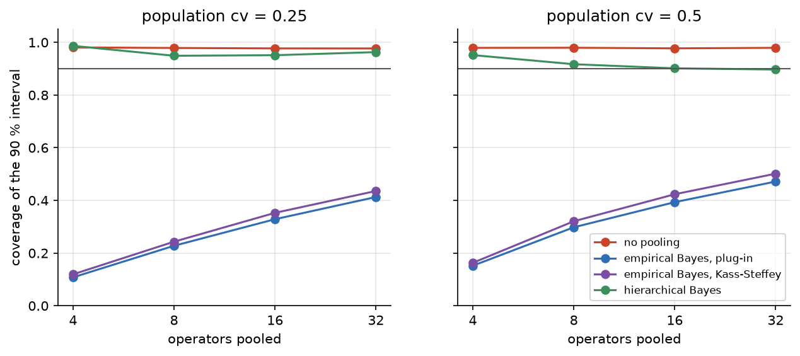

# Bayesian reliability for small fleets

[](https://github.com/GMCavalheri/bayesian-small-fleet-reliability/actions/workflows/ci.yml)

Airline reliability programmes watch each component's failure rate per 1000 flight hours and
raise an alert when it leaves its normal band. The method assumes a fleet big enough to log
several events a month. A business-jet fleet of five aircraft logs one starter-generator
removal every two years. This repository measures exactly how the classical method breaks on
such fleets, and how much established Bayesian methods recover:
- an informative prior from a related large fleet;
- empirical Bayes and full hierarchical pooling across operators;
- alerts stated as posterior probabilities with a cost-derived threshold;
- decisions under rate uncertainty.

The core is `smallfleet`, a typed Python package (NumPy, SciPy, PyMC, ArviZ). It includes an
exact quadrature solution of the hierarchical Gamma-Poisson model that reproduces the NRC
handbook's published examples digit for digit and checks MCMC. It comes with a nine-lesson
course that derives every method.



## Headline results (synthetic fleets with known truth, stated assumptions)

Component rates, utilisation, costs and targets are illustrative and labelled. Every number is
reproduced by `validation/run_all.py`, and CI fails if one changes.

| question | answer | where |
|---|---|---|
| Does the classical alert level work on five business jets? | No: the 12-month baseline has σ = 0 in 59 % of years, so the first event alerts; a year's 90 % interval is 7.3 times the rate; mean + 2σ false alarms drift from 3 to 11 % a month with fleet size | [Lesson 1](docs/lessons/01-the-alert-level-that-needs-a-big-fleet.md) |
| What does a large fleet's experience buy? | Discounted to 10 000 FH, RMSE 2.6 to 5.7 times lower than the MLE's; counted in full, intervals cover the truth 0 % of the time on 4 of 6 components, and the data cannot warn you (conflict check flags ≤ 2.7 % of years) | [Lesson 2](docs/lessons/02-borrowing-a-prior-from-a-bigger-fleet.md) |
| Can several small operators pool their data? | Plug-in empirical Bayes collapses to "all identical" in 40 to 71 % of cases and covers 11 to 50 %; exact hierarchical Bayes on the same data covers 0.90 to 0.99 with the lowest RMSE | [Lessons 3](docs/lessons/03-letting-the-data-choose-the-prior.md), [4](docs/lessons/04-partial-pooling.md) |
| Is a Bayesian alert better? | It is a count threshold with an exact false-alarm rate. On 25 aircraft it detects a doubling more often at matched false alarms (0.59 vs 0.45); on 5 no rule beats "alert on any event", but only the Bayesian one lets you choose the false-alarm rate | [Lesson 5](docs/lessons/05-an-alert-as-a-probability.md) |
| What does not knowing the rate cost? | A hidden failure's test interval: 1007 FH if the rate were known; 31 FH for a five-jet operator after a year of its own data; 331 FH with the large fleet's experience | [Lesson 6](docs/lessons/06-deciding-under-uncertainty.md) |
| How big is a big fleet? | With a correct prior, borrowing stays > 10 % better than the MLE up to ~400 aircraft-years; with a prior 3× off, the gain is gone by 20 aircraft and coverage is 36 % on 5 | [Lesson 7](docs/lessons/07-how-big-is-a-big-fleet.md) |
| Does it survive real wear-out data? | On NASA C-MAPSS lifetimes as renewal fleets, counts are under-dispersed (variance/mean 0.06 to 0.22), Poisson intervals over-cover, and partial pooling wins on short windows | [Lesson 8](docs/lessons/08-a-dataset-with-real-ground-truth.md) |

The full write-up is the [report](docs/report.md). What is and is not new is in
[related work](docs/related-work.md): the methods are established, and the contribution is
measurement and application.

## What is in it

| module | what it does |
|---|---|
| [`frequentist_baseline`](src/smallfleet/frequentist_baseline/) | MLE, exact Garwood interval, the alert levels of AMA 571.101/1, closed forms for their breakdown |
| [`bayesian_point_estimation`](src/smallfleet/bayesian_point_estimation/) | Gamma-Poisson, Jeffreys and constrained priors, power prior, conflict check, exact repeated-sampling performance |
| [`empirical_bayes`](src/smallfleet/empirical_bayes/) | negative-binomial marginal MLE, moments, plug-in and Kass-Steffey posteriors |
| [`hierarchical_model`](src/smallfleet/hierarchical_model/) | exact quadrature posterior, PyMC (marginal and centred) with diagnostics, predictive checks |
| [`bayesian_alert_thresholds`](src/smallfleet/bayesian_alert_thresholds/) | posterior-exceedance alerts, exact false-alarm rates, paired operating characteristics |
| [`decision_theory`](src/smallfleet/decision_theory/) | cost-derived thresholds, value of waiting (EVSI), failure-finding intervals under uncertainty |
| [`simulation_study`](src/smallfleet/simulation_study/) | exact single-fleet grid, Monte Carlo pooling with standard errors |
| [`cmapss`](src/smallfleet/cmapss/) | C-MAPSS lifetimes as stationary renewal fleets (data fetched separately) |

## Quickstart

```bash
git clone https://github.com/GMCavalheri/bayesian-small-fleet-reliability
cd bayesian-small-fleet-reliability
uv sync
uv run python validation/run_all.py      # every table and figure (about 15 minutes)
uv run pytest --cov                      # the test suite
uv run python scripts/fetch_cmapss.py    # optional: NASA C-MAPSS for Lesson 8 (12.4 MB)
```

```python
from smallfleet.bayesian_point_estimation import power_prior
from smallfleet.frequentist_baseline import garwood_interval, mle_rate

# one starter-generator removal in a year on five business jets (2100 FH)
print(mle_rate(1, 2100.0), garwood_interval(1, 2100.0, 0.90))
# borrow the large fleet's 171 removals in 900 000 FH, counted as 10 000 FH
post = power_prior(171, 900_000.0, 10_000.0).update(1, 2100.0)
print(post.mean(), post.interval(0.90), post.sf(0.375))
# 0.476 (0.024, 2.259)       <- classical: anything from almost nothing to 9x the truth
# 0.281 (0.085, 0.569) 0.231 <- borrowed: usable, and P(rate above 0.375) = 0.23
```

## Documentation

* **Course:** [`docs/lessons/`](docs/lessons/README.md), nine lessons with derivations, worked
  examples and exercises with solutions, and one executed notebook per lesson in
  [`notebooks/`](notebooks/).
* **Theory notes:** one per module in [`docs/`](docs/).
* **Report:** [`docs/report.md`](docs/report.md). **Related work:**
  [`docs/related-work.md`](docs/related-work.md). **Scope:** [`docs/scope.md`](docs/scope.md).
* **Results:** [`validation/results/`](validation/results/), regenerated by the scripts in
  [`validation/`](validation/).

## Engineering

* 175 tests (pytest + Hypothesis), about 98 % branch coverage with a 90 % gate. Every test
  asserts against a closed form, a published value or an independent oracle:
  - published values: NUREG/CR-6823 Table 6.4, Tables 8.2 and 8.3, the WinBUGS results of
    Table 8.7 and X² = 378.5; Transport Canada AMA 571.101/1 example 4(a);
  - oracles: numerical integration, `dblquad`, an exact quadrature posterior, independent
    optimisers, and Monte Carlo within its own standard error;
  - simulation-based calibration of the Bayesian engine.
* Property tests check that a posterior mean lies between the prior mean and the MLE, that
  exceedance probabilities rise with the count, that partial pooling keeps the order of the
  units and shrinks their spread, and that the value of information is never negative.
* `ruff`, strict `mypy`, CI on Python 3.11–3.13, gitleaks and pip-audit, Dependabot.
* A `reproduce` CI job reruns every validation script, fails if any committed table changes,
  and executes every notebook. Two documented exceptions: the NUTS comparison (trajectories
  depend on the compiled model's floating point, so its agreement with the exact posterior is
  a test instead), and C-MAPSS (data not in the repository).
* **Not included, on purpose:** this is a library and a course, not a deployed service, so there
  is no staging environment, observability stack or feature-flag service.

## Deviations from the plan

* The plan expected the classical alert level to come from AVR-02, the
  [fleet reliability dashboard](https://github.com/GMCavalheri/Aircraft-Fleet-Reliability-Dashboard).
  That project computes rates and MTBF but no alert levels, so they are implemented here from
  FAA AC 120-17B and Transport Canada AMA 571.101/1.
* The "large-fleet" prior population is generated here from the same component table, rather
  than imported from AVR-02.
* C-MAPSS uses the original FD001–FD004 subsets as four fleets. Their lifetimes become renewal
  processes with a known long-run rate. This replaces "groups with known ground truth", since
  C-MAPSS has no failure-rate truth of its own.
* Added beyond the plan: an empirical Bayes tier, the exact quadrature oracle, a decision-theory
  module (the plan's second extension), and the related-work study.

## Licence

MIT. See [LICENSE](LICENSE). NASA C-MAPSS is public data of the US Government, downloaded by
the user and not redistributed here; cite Saxena and Goebel (2008).
