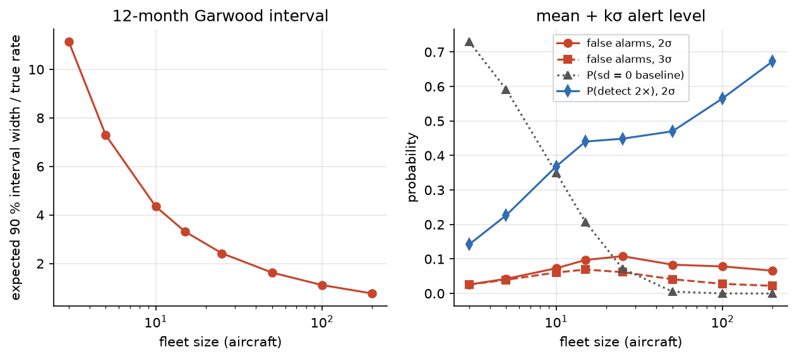

# Lesson 1 · The alert level that needs a big fleet

> An airline reliability programme watches each component's monthly failure rate and raises
> an alert when it crosses a line drawn at the mean plus two or three standard deviations.
> On a hundred airliners the line means something. On five business jets, most months show
> no failures, the "standard deviation" is often exactly zero, and a single removal sets off
> the alarm. This lesson builds the classical method and measures how it degrades with fleet
> size. The rest of the course replaces it with Bayesian methods.

**Code:** [`src/smallfleet/frequentist_baseline/`](../../src/smallfleet/frequentist_baseline/),
[`src/smallfleet/data_generation.py`](../../src/smallfleet/data_generation.py) ·
**Data:** [`component_parameters.csv`](../../src/smallfleet/data/component_parameters.csv),
[`fleet_parameters.csv`](../../src/smallfleet/data/fleet_parameters.csv) ·
**Tests:** [`tests/test_frequentist_baseline.py`](../../tests/test_frequentist_baseline.py) ·
**Results:** [`validation/results/frequentist.md`](../../validation/results/frequentist.md) ·
**Scope:** [`docs/scope.md`](../scope.md)

## Learning objectives

By the end of this lesson you should be able to:

1. State the Poisson model behind a reliability programme's failure rates, and compute the
   expected number of events per month from a rate, a fleet size and a utilisation.
2. Compute the classical alert levels (mean + kσ, a multiple of the mean, the 95 % Poisson
   limit) the way regulators' worked examples do.
3. Compute the exact (Garwood) confidence interval of a Poisson rate, and explain why it is
   conservative.
4. Derive, in closed form, how often a month has no events and how often a 12-month baseline
   has zero spread.
5. Explain, with numbers, why the classical alert level breaks down on a small fleet.

---

## 1. The classical method

A reliability programme turns maintenance records into rates. FAA AC 120-17B, §4.1, says a
performance standard "is expressed numerically, as a number, rate, ratio, or percentage", and
that control limits or alert values "should be based on generally accepted statistical
methods, such as standard deviation or the Poisson distribution". The usual unit is events
per 1000 flight hours (FH). For component $c$ in month $j$:

```math
r_j = 1000 \cdot \frac{y_j}{T_j},
```

where $y_j$ is the number of unscheduled removals and $T_j$ the fleet's flight hours in the
month. Transport Canada's AMA 571.101/1, Appendix A, works out the common alert levels on a
baseline of $N = 12$ points:

| method | alert level | AMA 571.101/1 example |
|---|---|---|
| multiple of the mean | $1.3 \bar r$ | mean 20, level 26 |
| mean + 2σ | $\bar r + 2s$ | $20.17 + 2 \times 2.764 = 25.69$ |
| mean + 3σ | $\bar r + 3s$ | $20 + 3 \times 2.77 = 28.31$ |
| Poisson | smallest $A$ with $P(Y \le A) \ge 0.95$, $Y \sim \text{Poisson}(\lambda t)$ | expected 9.9, $A = 15$ |

The standard deviation there uses the population divisor:

```math
\bar r = \frac{1}{N}\sum_{j=1}^{N} r_j, \qquad s = \sqrt{\frac{1}{N}\sum_{j=1}^{N} (r_j - \bar r)^2} .
```

The page gives the false-alarm probability of the 2σ level as about 4.5 % and of the 3σ level
as 0.3 %. Those are the two-sided tail areas of a **normal** distribution. Keep that in mind:
they hold only when monthly rates are roughly normal, which needs many events per month.

An alert does not mean the component is unairworthy. AC 120-17B, §4.2.1, calls it a means
"of readily identifying increases in failure rates that fall outside the parameters of what
is considered normal performance variation". The level should be neither so high that a
major increase never alerts, nor so low that normal scatter alerts all the time. That balance
is exactly what we will measure.

> **Check the source yourself.** Example 4(b) of AMA 571.101/1 reads $A = 8$ from the chart
> for an expected 5 removals. But $P(Y \le 8 \mid 5) = 0.932 < 0.95$, so the 95 % rule gives
> $A = 9$. Example 4(a), with $P(Y \le 15 \mid 10) = 0.951$, reproduces. Our test pins 4(a),
> and the comment records the 4(b) discrepancy. Reading a value off a printed chart is error
> prone; a function is not.

## 2. The model underneath: a Poisson count

If failures arrive at a constant rate $\lambda$ per 1000 FH, independently of each other,
the count in a month of $T_j$ flight hours is Poisson:

```math
y_j \sim \text{Poisson}(m_j), \qquad m_j = \frac{\lambda T_j}{1000} .
```

Everything depends on $m$, the **expected number of events per month**. For a fleet of $n$
aircraft flying $u$ hours each per month, $m = \lambda n u / 1000$. Our parameter tables give
(as labelled, illustrative assumptions) $u = 35$ FH per aircraft-month for a business jet and
$u = 250$ for a narrow-body airliner, and a starter-generator removal rate of $0.25$ per 1000
FH on the business jet. So:

| fleet | $m$ per month |
|---|---|
| 5 business jets | 0.044 |
| 50 business jets | 0.44 |
| 100 narrow-bodies (large-fleet rate 0.20) | 5 |

The classical method was designed for the last row. The first row is a different world.

## 3. What happens when m is small

### Zero months

```math
P(y_j = 0) = e^{-m} .
```

For 5 business jets that is $e^{-0.044} = 0.957$: 23 months in 24 show a rate of exactly 0.
A month with one event shows $1000 / 175 = 5.7$ per 1000 FH, 23 times the true rate. The
monthly rate cannot take any value in between. It is not a noisy measurement of $\lambda$; it
is a coin that almost always lands on zero.

### Degenerate baselines

The mean + kσ level needs a spread. The spread is zero whenever all twelve baseline months
have the same count:

```math
P(s = 0) = \sum_{k=0}^{\infty} P(y = k)^{12} \approx e^{-12m} \quad (m \text{ small}).
```

For 5 business jets this is $0.59$. In 59 % of years the alert level is the mean itself,
almost always zero, and the **first event alerts**. When the baseline holds a single event,
the level is $(1 + 2\sqrt{11})/12 \approx 0.64$ of that one event's rate, so the next event
alerts again. EASA's guidance names this case directly. Appendix I to AMC M.A.302, §6.2,
treats a fleet of fewer than 6 aircraft of one type as a small fleet, and says its alert
levels "should be used carefully" (as itemised in the Bahrain CAA checklist ALD/AIR/F170,
Rev. 5, 2023). The same section's answer is to **pool data**, which is the idea Lessons 3
and 4 make precise.

### The interval

The exact two-sided interval for a Poisson rate (Garwood, 1936) inverts the two Poisson
tails. With $Y$ events in $T$ flight hours and $t = T/1000$:

```math
L = \frac{\chi^2_{\alpha/2}(2Y)}{2t}, \qquad U = \frac{\chi^2_{1-\alpha/2}(2Y + 2)}{2t}, \qquad L = 0 \text{ if } Y = 0 .
```

Because $Y$ is discrete, the coverage cannot equal $1 - \alpha$ at every $\lambda$. Garwood's
construction guarantees **at least** $1 - \alpha$. Our test computes the coverage exactly, by
summing the Poisson pmf over every $Y$ whose interval contains $\lambda$, and checks it never
drops below nominal. Two special cases have closed forms worth knowing, because $\chi^2(2)$ is
an exponential with mean 2:

```math
U(Y=0) = \frac{-\ln(\alpha/2)}{t}, \qquad L(Y=1) = \frac{-\ln(1-\alpha/2)}{t} .
```

For large counts the relative width tends to $2z_{1-\alpha/2}/\sqrt{m_{\text{total}}}$. It
falls only as one over the square root of the number of events you expect to see.

## 4. Measuring the breakdown

[`validation/frequentist.py`](../../validation/frequentist.py) runs the starter-generator at
its true small-fleet rate over fleets of 3 to 200 business jets. The probabilities of a zero
month and of a degenerate baseline, the interval width and the coverage are exact. The
operating characteristics are seeded Monte Carlo with 20 000 replicates. A false alarm is a
monitored month above the level set on the previous 12 months at the same true rate. A
detection is any alert in the 3 months after the rate doubles.



From [`validation/results/frequentist.md`](../../validation/results/frequentist.md):

| aircraft | events per month | P(sd = 0) | 12-month 90 % width / λ | false alarms, 2σ | P(detect 2×), 2σ |
|---|---|---|---|---|---|
| 5 | 0.0437 | 0.592 | 7.29 | 0.042 | 0.23 |
| 15 | 0.1313 | 0.207 | 3.31 | 0.097 | 0.44 |
| 50 | 0.4375 | 0.005 | 1.63 | 0.083 | 0.47 |
| 200 | 1.75 | 0 | 0.77 | 0.066 | 0.67 |

Read it in three steps.

1. **Estimation.** With 5 aircraft, a year of data gives a 90 % interval about 7 times as wide
   as the rate itself. The data cannot tell a good starter-generator from one twice as bad.
2. **False alarms.** The 2σ level is supposed to give a few percent of spurious alerts. On
   the small fleets it alerts in 3 to 11 % of months. Even the 100-narrow-body reference
   (5 events per month) shows 5.9 %, above the 2.3 % one-sided normal tail, because the
   baseline's mean and σ are themselves estimated from only 12 points.
3. **Detection.** A doubling of the true rate is caught within a quarter only 23 % of the
   time on 5 aircraft, and 67 % on 200. On the smallest fleets the false-alarm and detection
   rates are both governed by one fact: almost every alert is the first event in a quiet year.

So the classical method on a small fleet has two failure modes at once: it cries wolf on
single events, and it cannot see a real doubling. Neither is fixed by changing k.

## 5. What this lesson does not claim

* The rates are illustrative assumptions, not field data of any operator or manufacturer. The
  shape of the result (everything is a function of $m$) does not depend on them.
* Real programmes use refinements (3-month running averages, two-consecutive-month rules,
  removal versus confirmed-failure rates). They change the numbers but not the cause: with
  $m \ll 1$ any rule built on monthly rates is a rule about single events.
* A constant rate is an assumption. Lesson 8 (C-MAPSS) meets data where it is not.

### Plan deviations

* The PLAN expected the classical alert level to come from AVR-02, the fleet reliability
  dashboard. That project computes rates and MTBF but not alert levels, so the method is
  written here, from AC 120-17B and AMA 571.101/1.
* The large fleet that supplies the prior in Lesson 2 is generated here from the same
  component table, so this project does not depend on AVR-02's code.

## 6. Worked example

Five business jets, 35 FH per aircraft-month, one year: $T = 2100$ FH, $t = 2.1$.

* **No removals.** $\hat\lambda = 0$, and the 90 % interval is
  $(0, -\ln(0.05)/2.1) = (0, 1.43)$ per 1000 FH. Zero events do not mean a zero rate. They mean "below about 1.4".
* **One removal.** $\hat\lambda = 0.476$, interval $(0.0244, 2.26)$: a factor of 93 between
  the ends.
* **Two removals.** $\hat\lambda = 0.952$, interval $(0.169, 3.00)$.

The true rate is 0.25. Whatever the year shows, the classical answer is "somewhere between
almost nothing and several times the truth". Lesson 2 adds the one thing a 5-aircraft
operator does have: a large fleet that flies the same part.

## 7. Code walkthrough

```python
import numpy as np

from smallfleet.data_generation import simulate_history
from smallfleet.frequentist_baseline import (
    garwood_interval,
    mean_sd_alert_level,
    mle_rate,
    monthly_rates,
)

rng = np.random.default_rng(1)
history = simulate_history(rng, rate=0.25, n_aircraft=5, fh_per_aircraft_month=35.0, months=24)
baseline = monthly_rates(history.counts[:12], history.exposure_fh[:12])
level = mean_sd_alert_level(baseline, k=2.0)  # mean + 2 sd, population divisor
print(mle_rate(history.total_count, history.total_exposure_fh))
print(garwood_interval(history.total_count, history.total_exposure_fh, 0.90))
```

* `simulate_history` draws $y_j \sim \text{Poisson}(\lambda T_j/1000)$ from a seeded generator.
* `garwood_interval` uses `scipy.stats.chi2.ppf`; `garwood_coverage` sums the Poisson pmf over
  every count to give the exact coverage.
* `degenerate_baseline_probability` is $\sum_k \text{pmf}(k)^{12}$, truncated where the pmf
  falls below $10^{-15}$.
* `mean_sd_operating_characteristics` vectorises the Monte Carlo over replicates and returns
  the standard error of each estimate.

## Exercises

1. A fleet of 8 aircraft flies 40 FH per aircraft-month. A component's true rate is 0.1 per
   1000 FH. What is $m$, and what is the probability that a 12-month baseline is all zeros?
2. Show that a baseline with exactly one event in 12 months gives a mean + 2σ level of
   $(1 + 2\sqrt{11})/12$ times that event's monthly rate.
3. Using the closed form, give the 95 % upper limit for a rate after a year with zero events
   on the fleet of exercise 1.
4. Why does the 100-narrow-body reference show 5.9 % false alarms with a 2σ rule, more than
   the normal tail of 2.3 %? Name two causes.
5. AMA 571.101/1 example 4(b) reads $A = 8$ for an expected count of 5. What probability
   level would make 8 the right answer, and what does that suggest about the chart?

### Solutions

1. $m = 0.1 \times 8 \times 40 / 1000 = 0.032$; $P = e^{-12 \times 0.032} = e^{-0.384} = 0.68$.
2. The rates are $r$ once and 0 eleven times. The mean is $r/12$. The population variance is
   $\frac{1}{12}\left[(r - r/12)^2 + 11 (r/12)^2\right] = 11 r^2/144$, so $s = r\sqrt{11}/12$
   and $\bar r + 2s = r(1 + 2\sqrt{11})/12 \approx 0.64 r$.
3. $t = 8 \times 40 \times 12 / 1000 = 3.84$; $U = -\ln(0.025)/3.84 = 3.689/3.84 = 0.96$ per
   1000 FH, almost ten times the true 0.1.
4. Monthly counts with mean 5 are skewed to the right, so the upper tail is heavier than the
   normal one. And the level uses an estimated mean and σ from only 12 points, so in some
   years σ comes out small and the level low.
5. $P(Y \le 8 \mid 5) = 0.932$, so 8 is the 93 % point, not the 95 % point. A chart read by eye
   between curves can easily be off by one; the operator's procedure should define the
   limit by formula.

## References

* FAA, *Reliability Program Methods — Standards for Determining Time Limitations*, Advisory
  Circular 120-17B, 2018, §4.1 and §4.2.1.
* Transport Canada, *Airworthiness Manual Advisory 571.101/1, Appendix A: Calculation of
  Alert Levels* (examples 1–4).
* EASA, Appendix I to AMC M.A.302, §6.2, "Applicability, small fleets", as itemised in Bahrain
  CAA, *Maintenance Programme Compliance Checklist*, form ALD/AIR/F170, Rev. 5, 2023.
* F. Garwood, "Fiducial limits for the Poisson distribution," *Biometrika* 28(3/4), 1936
  (the exact interval).
* D. C. Montgomery, *Introduction to Statistical Quality Control*, 7th ed., Wiley, 2012
  (control charts for counts, and why normal-theory limits fail for small means).
* M. Rausand and A. Høyland, *System Reliability Theory*, 2nd ed., Wiley, 2004 (the
  homogeneous Poisson process and rate estimation).
