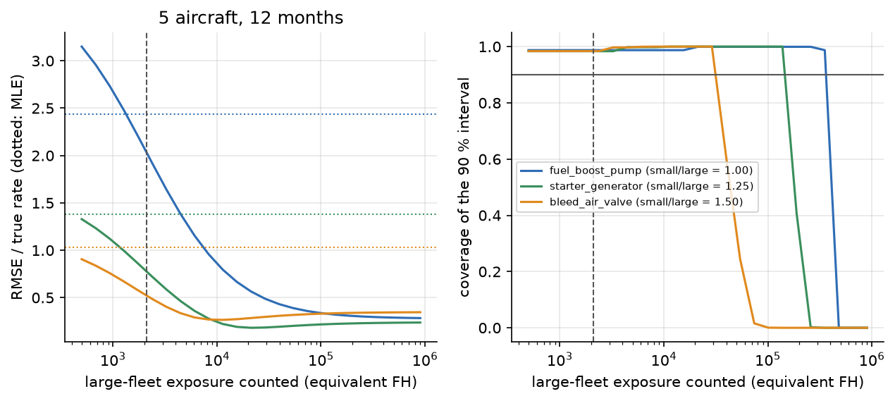

# Lesson 2 · Borrowing a prior from a bigger fleet

> A five-aircraft operator logs one starter-generator removal in a year. On its own data the
> rate is "somewhere between 0.02 and 2.3 per 1000 FH". But the same part flies on a hundred
> airliners that have logged 171 removals in 900 000 hours. Bayes' theorem is the rule for
> combining the two, and the conjugate Gamma-Poisson model does it with two additions. This
> lesson builds the model and reproduces a published worked example. It also shows the
> trap: borrow too much and the answer is precise, confident and wrong.

**Code:** [`src/smallfleet/bayesian_point_estimation/`](../../src/smallfleet/bayesian_point_estimation/) ·
**Tests:** [`tests/test_bayesian_point_estimation.py`](../../tests/test_bayesian_point_estimation.py) ·
**Results:** [`validation/results/bayes_point.md`](../../validation/results/bayes_point.md) ·
**Previous:** [Lesson 1](01-the-alert-level-that-needs-a-big-fleet.md)

## Learning objectives

By the end of this lesson you should be able to:

1. Derive the Gamma-Poisson posterior and read a Gamma prior as "α events in β units of
   exposure".
2. Compute posterior means, equal-tailed and highest-density credible intervals, and the
   negative-binomial predictive distribution of next year's count.
3. Build a prior from a related large fleet with a power prior or variance inflation, and
   explain what the discount means.
4. Run a prior-data conflict check, and explain why on a small fleet it has almost no power.
5. Read the bias-variance trade-off of borrowing from the exact repeated-sampling results.

---

## 1. Bayes' theorem for a rate

The data are $y$ events in $t$ units of exposure (here thousands of flight hours). The
likelihood of a rate $\lambda$ is Poisson:

```math
p(y \mid \lambda) = \frac{(\lambda t)^y e^{-\lambda t}}{y!} \propto \lambda^{y} e^{-\lambda t} .
```

A Gamma prior in the shape-rate form,

```math
p(\lambda) = \frac{\beta^\alpha}{\Gamma(\alpha)} \lambda^{\alpha - 1} e^{-\beta\lambda}, \qquad E[\lambda] = \frac{\alpha}{\beta}, \qquad \text{Var}[\lambda] = \frac{\alpha}{\beta^2},
```

has the same functional form in $\lambda$ as the likelihood. Multiplying them:

```math
p(\lambda \mid y) \propto \lambda^{\alpha + y - 1} e^{-(\beta + t)\lambda} \quad\Longrightarrow\quad \lambda \mid y \sim \text{Gamma}(\alpha + y,\ \beta + t) .
```

That is **conjugacy**: the posterior is in the prior's family, and updating is addition. It
gives the prior a concrete meaning: a Gamma(α, β) prior is worth **α events seen in β units
of exposure** before the current data (NUREG/CR-6823, §6.2.2.4). The posterior mean is a
weighted average of the prior mean and the MLE $y/t$:

```math
E[\lambda \mid y] = \frac{\alpha + y}{\beta + t} = w \cdot \frac{\alpha}{\beta} + (1 - w) \cdot \frac{y}{t}, \qquad w = \frac{\beta}{\beta + t} .
```

The weight on the prior is the share of the total exposure that the prior "brings". A
Hypothesis test checks that the posterior mean always lies between the two, for any prior and
data.

> **A unit trap.** `scipy.stats.gamma` takes a *scale* $= 1/\beta$, not a rate. NUREG/CR-6823
> warns about the same thing. Every Gamma in this package goes through `GammaRate`, which
> does the conversion in one place.

## 2. A published example, reproduced

NUREG/CR-6823 (Atwood et al., 2003), Example 6.1, has 1 initiating event in 4.89
reactor-critical-years. Its Table 6.4 compares four answers. The test file reproduces every
number to the printed precision.

| method | posterior | mean | 90 % interval |
|---|---|---|---|
| frequentist (Garwood) | — | 0.20 | (0.010, 0.97) |
| Jeffreys prior Gamma(0.5, 0) | Gamma(1.5, 4.89) | 0.31 | (0.036, 0.80) |
| industry prior Gamma(1.53, 10.63) | Gamma(2.53, 15.52) | 0.16 | (0.038, 0.36) |
| constrained noninformative, mean 0.144 | Gamma(1.5, 8.36) | 0.18 | (0.021, 0.47) |

Three priors appear here, and you will meet them all again:

* **Jeffreys**, Gamma(½, 0): improper (it does not integrate), but its posterior after any
  exposure is proper. Its credible interval is numerically close to the confidence interval.
  It adds half an event, so its posterior mean $(y + ½)/t$ is biased upward when $y$ is
  tiny. Our results show that cost: on five aircraft the Jeffreys mean has a larger RMSE
  than the MLE.
* **Constrained noninformative** (Atwood, 1996), Gamma(½, 1/(2μ)): the most diffuse Gamma with
  a given mean μ. It is useful when you trust a generic mean but not its spread.
* **Informative**: a Gamma fitted to generic or industry data. This is the case we care about.

## 3. Intervals and predictions

**Equal-tailed interval:** the 5th and 95th percentiles. NUREG/CR-6823 prefers it because the
right tail is what matters for risk. **Highest-density (HPD) interval:** the shortest
interval with the given mass. Its two ends have equal density, and for α ≤ 1 it starts at
zero. `GammaRate.hpd` finds it by minimising the width over the lower-tail probability.

**Predictive distribution.** Next year's count $\tilde y$ in exposure $s$ mixes a Poisson
over the posterior:

```math
P(\tilde y = k) = \int_0^\infty \frac{(\lambda s)^k e^{-\lambda s}}{k!}\, \text{Gamma}(\lambda \mid \alpha, \beta)\, d\lambda = \frac{\Gamma(\alpha + k)}{\Gamma(\alpha)\, k!}\, p^\alpha (1 - p)^k, \qquad p = \frac{\beta}{\beta + s},
```

a negative binomial. It is wider than any single Poisson because it carries the uncertainty
about λ. The tests check it against numerical integration and Monte Carlo.

## 4. Borrowing from a large fleet

Our large fleet is 100 narrow-bodies over 36 months, 900 000 FH (simulated once, seed in the
results). If the small fleet had **exactly the same rate**, the right prior would be the large
fleet's posterior. For the starter-generator that is Gamma(171.5, 900), a 90 % interval of
(0.168, 0.216). But the business jet's true rate is 0.25 (the component table says why:
more starts per flight hour). The borrowed prior is precise about the wrong fleet.

Two standard ways to **discount** it:

* **Power prior** (Ibrahim & Chen, 2000): raise the large-fleet likelihood to $a_0 \in [0, 1]$.
  For Poisson data with a Jeffreys initial prior this gives

  ```math
  \lambda \sim \text{Gamma}\left(\tfrac12 + a_0 Y,\ a_0 T\right),
  ```

  so the large fleet's $T$ hours count as $a_0 T$. We set $a_0$ through that **equivalent
  exposure**: 10 000 FH, about five years of the small fleet, gives $a_0 = 0.0111$ and the
  prior Gamma(2.4, 10).
* **Variance inflation:** keep the mean and multiply the variance by $k$, which divides both
  α and β by $k$. For a Gamma prior this is the power prior with $a_0 = 1/k$, apart from the
  initial half event.

The discount is a statement about how different the two fleets may be. It is not estimated
from the small fleet's data here, and it cannot be (Section 5). Lessons 3 and 4 estimate it
from several components at once.

## 5. Results: precise, or right?

Exact repeated-sampling performance for 5 aircraft and 12 months (2100 FH), summed over the
Poisson count at the true rate. Excerpt from
[`validation/results/bayes_point.md`](../../validation/results/bayes_point.md):

| component (small/large rate) | method | RMSE / λ | 90 % coverage | width / λ |
|---|---|---|---|---|
| starter-generator (1.25) | MLE + Garwood | 1.38 | 0.984 | 7.29 |
| | Jeffreys | 1.68 | 0.902 | 5.33 |
| | power prior, 10 000 FH | 0.242 | 1 | 1.77 |
| | full borrowing | 0.237 | 0 | 0.191 |
| bleed-air valve (1.5) | MLE + Garwood | 1.03 | 0.984 | 4.68 |
| | power prior, 10 000 FH | 0.265 | 1 | 1.22 |
| | full borrowing | 0.346 | 0 | 0.132 |



1. **Borrowing works.** The discounted prior cuts the RMSE by a factor of 2.6 to 5.7 and the
   interval width by a factor of 4 to 6, on every component.
2. **Borrowing everything fails.** Full borrowing has the smallest interval and **zero
   coverage** on four of the six components. Its interval sits on the large fleet's
   estimate, so it covers the truth only where that estimate happens to land close (the
   weather radar and the brake assembly). The right panel shows coverage falling off a
   cliff once the counted exposure passes about 30 000 FH for the bleed-air valve, and later
   for components closer to the large fleet.
3. **Even "the same part" is not the same.** The fuel boost pump has equal true rates, yet
   full borrowing still misses: the simulated large fleet logged 92 removals where 72 were
   expected (a 2.4σ draw), and 900 000 FH of exposure leaves no room for that error.
4. **The discounted prior over-covers** (coverage near 1). It is conservative. Lesson 4's
   hierarchical model sizes the discount from the data instead of by hand.

### Can the data warn you?

The prior-predictive check (Box, 1980) asks how surprising the observed count is under the
prior's negative binomial. With full borrowing, the chance that a year's data flags the
bleed-air valve's 50 % rate difference at the 5 % level is **0.016**, and 0.106 after five
years. A small fleet cannot detect that its prior is wrong, because its data are too few
to contradict anything. The discount has to come from engineering reasoning or from a model
that compares several components.

## 6. Worked example

Five business jets, one starter-generator removal in 2100 FH, so $t = 2.1$.

| prior | posterior | mean | 90 % interval |
|---|---|---|---|
| Jeffreys, Gamma(0.5, 0) | Gamma(1.5, 2.1) | 0.714 | (0.084, 1.861) |
| power prior, 10 000 FH: Gamma(2.4, 10) | Gamma(3.4, 12.1) | 0.281 | (0.085, 0.569) |
| full borrowing, Gamma(171.5, 900) | Gamma(172.5, 902.1) | 0.191 | (0.168, 0.216) |
| full borrowing, variance × 4: Gamma(42.9, 225) | Gamma(43.9, 227.1) | 0.193 | (0.148, 0.244) |

The true rate is 0.25. Only the discounted power prior's interval contains it while being
narrow enough to act on. Variance inflation by 4 is still too confident: 900 000 FH divided
by 4 is still 100 times the small fleet's exposure.

## 7. Code walkthrough

```python
from smallfleet.bayesian_point_estimation import (
    bayes_estimator,
    exact_performance,
    power_prior,
    prior_predictive_pvalue,
)

prior = power_prior(large_count=171, large_exposure_fh=900_000.0, equivalent_fh=10_000.0)
post = prior.update(1, 2100.0)  # Gamma(alpha + y, beta + t/1000)
print(post.mean(), post.interval(0.90), post.hpd(0.90))
print(prior.predictive(2100.0).pmf(0))  # P(no removal next year)
print(prior_predictive_pvalue(prior, 1, 2100.0))  # conflict check
print(exact_performance(bayes_estimator(prior), rate=0.25, exposure_fh=2100.0))
```

* `GammaRate` holds (α, β); `update` adds the count and the exposure in thousands of FH.
* `power_prior` turns an equivalent exposure into $a_0$ and returns Gamma(½ + a₀Y, a₀T).
* `exact_performance` sums the estimator's error, hit and width over every Poisson count,
  weighted by the pmf. That is why the results table has no Monte Carlo error.

## Exercises

1. A prior is Gamma(3, 15) per 1000 FH. What are its mean and its "equivalent data"? After
   2 events in 5000 FH, what is the posterior, and what weight does the prior carry?
2. Show that variance inflation by $k$ of a Gamma(α, β) prior is a Gamma(α/k, β/k), and that
   it keeps the mean.
3. With the Jeffreys prior and zero events in $t$, give the posterior mean. Why can it be
   *worse* than the MLE of 0 when the true rate is small?
4. The large fleet's 900 000 FH give a posterior standard deviation of about 0.015 for the
   starter-generator. What equivalent exposure would make the prior's standard deviation
   equal to the 0.05 gap between the two fleets' rates?
5. Why does the prior-data conflict check have so little power in a 2100 FH year? Answer in
   terms of the predictive distribution's spread.

### Solutions

1. Mean 0.2, worth 3 events in 15 000 FH. Posterior Gamma(5, 20), mean 0.25; the prior's
   weight is $15/(15 + 5) = 0.75$.
2. Gamma(α/k, β/k) has mean $(α/k)/(β/k) = α/β$ and variance $(α/k)/(β/k)^2 = k α/β^2$.
3. $0.5/t$. At $t = 2.1$ that is 0.24 per 1000 FH: half an event spread over a small
   exposure. If the true rate is 0.04, the MLE's 0 is closer than 0.24 most of the time.
4. With equivalent exposure $E$ (thousands of FH) and mean ≈ 0.19, the sd is
   $\sqrt{α}/β \approx \sqrt{0.19 E}/E = \sqrt{0.19/E}$. Setting it to 0.05 gives
   $E = 0.19/0.0025 = 76$, about 76 000 FH. Beyond that the prior is surer than the fleets
   are alike, which matches where coverage starts to fall in the figure.
5. With full borrowing the predictive is close to Poisson(0.40): $P(0) = 0.67$,
   $P(1) = 0.27$, $P(2) = 0.054$. Counts 0 to 2 are all unsurprising, and the true rate (0.25,
   mean 0.53) mostly produces them. The 25 % rate difference moves the mean count by about
   0.13 of an event, far inside the spread.

## References

* C. L. Atwood, D. L. LaChance, H. F. Martz, D. J. Anderson, M. Englehardt, D. Whitehead and
  T. Wheeler, *Handbook of Parameter Estimation for Probabilistic Risk Assessment*,
  NUREG/CR-6823, U.S. Nuclear Regulatory Commission, 2003 (Example 6.1, §6.2.2, Table 6.4).
* C. L. Atwood, "Constrained noninformative priors in risk assessment," *Reliability
  Engineering & System Safety* 53(1), 1996.
* J. G. Ibrahim and M.-H. Chen, "Power prior distributions for regression models,"
  *Statistical Science* 15(1), 2000.
* G. E. P. Box, "Sampling and Bayes' inference in scientific modelling and robustness,"
  *Journal of the Royal Statistical Society A* 143(4), 1980 (prior-predictive checks).
* H. Jeffreys, *Theory of Probability*, 3rd ed., Oxford University Press, 1961.
* M. S. Hamada, A. G. Wilson, C. S. Reese and H. F. Martz, *Bayesian Reliability*, Springer,
  2008 (Gamma-Poisson models in reliability).
* A. Gelman, J. B. Carlin, H. S. Stern, D. B. Dunson, A. Vehtari and D. B. Rubin, *Bayesian
  Data Analysis*, 3rd ed., CRC Press, 2013 (conjugate Poisson models, predictive checks).
