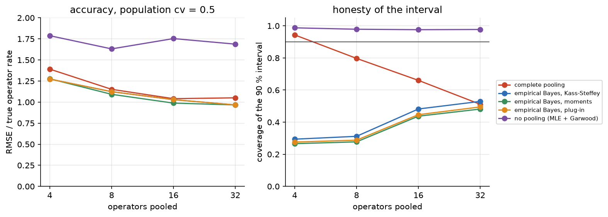

# Lesson 3 · Letting the data choose the prior

> Lesson 2 borrowed a prior from a large fleet and had to choose, by hand, how much to trust
> it. A manufacturer has a better source: many small operators of the *same* type, each with
> a few aircraft and a few events. If their rates come from one population, the population
> itself can be estimated from all of them, and each operator's estimate can lean on it.
> That is empirical Bayes. It works well on a large, data-rich group. This lesson shows
> where it breaks: on a handful of sparse operators it becomes confidently wrong.

**Code:** [`src/smallfleet/empirical_bayes/`](../../src/smallfleet/empirical_bayes/) ·
**Tests:** [`tests/test_empirical_bayes.py`](../../tests/test_empirical_bayes.py) ·
**Data (test fixture):** [`nureg6823_example_8_1.csv`](../../tests/data/nureg6823_example_8_1.csv) ·
**Results:** [`validation/results/empirical_bayes.md`](../../validation/results/empirical_bayes.md) ·
**Previous:** [Lesson 2](02-borrowing-a-prior-from-a-bigger-fleet.md)

## Learning objectives

By the end of this lesson you should be able to:

1. Write the two-level Gamma-Poisson model for many units and derive its negative-binomial
   marginal likelihood.
2. Estimate the population parameters by maximum marginal likelihood and by moments.
3. Explain shrinkage: why each unit's estimate moves towards the population mean, and by how
   much.
4. Explain why plug-in empirical Bayes intervals are too narrow, and apply the Kass-Steffey
   adjustment.
5. Recognise the two failure modes of empirical Bayes on sparse data: no events, and an
   estimated spread of exactly zero.

---

## 1. Many units, one population

Take $m$ units: operators, fleets or plants. Unit $i$ logs $x_i$ events in exposure $t_i$
(thousands of FH). Each has its own rate $\lambda_i$, and the rates are draws from one
**population-variability distribution**:

```math
x_i \mid \lambda_i \sim \text{Poisson}(\lambda_i t_i), \qquad \lambda_i \sim \text{Gamma}(\alpha, \beta), \qquad i = 1, \dots, m .
```

The population has mean $\mu = \alpha/\beta$ and coefficient of variation
$\text{cv} = 1/\sqrt{\alpha}$. Two extremes bracket the model:

* **no pooling** ($\text{cv} \to \infty$): each unit stands alone, as in Lesson 1;
* **complete pooling** ($\text{cv} = 0$): all units share one rate, $\sum x_i / \sum t_i$.

The assumption behind the model is **exchangeability**: before seeing the data, nothing
tells you that one operator's rate should be higher than another's. If something does (one
operator flies in a desert), it belongs in the model as a covariate, not in the population.

## 2. The marginal likelihood

Integrate each $\lambda_i$ out. Lesson 2 did exactly this for the predictive distribution:

```math
P(x_i \mid \alpha, \beta) = \frac{\Gamma(\alpha + x_i)}{\Gamma(\alpha)\, x_i!} \left(\frac{\beta}{\beta + t_i}\right)^{\alpha} \left(\frac{t_i}{\beta + t_i}\right)^{x_i} .
```

Each count is negative binomial with mean $\mu t_i$ and variance $\mu t_i + \mu^2 t_i^2 / \alpha$.
The second term, **extra-Poisson variation**, is the only evidence the data give about the
spread between units. The log marginal likelihood $\ell(\alpha, \beta) = \sum_i \log P(x_i \mid \alpha, \beta)$
is a function of two numbers, whatever the number of units.

### Maximum marginal likelihood

`fit_marginal_mle` maximises $\ell$ over $(\log\mu, \log\alpha)$ with bounded L-BFGS-B and the
analytic score

```math
\frac{\partial \ell}{\partial \log \mu} = \sum_i \left[x_i - \frac{(\alpha + x_i)\mu t_i}{\alpha + \mu t_i}\right], \qquad
\frac{\partial \ell}{\partial \log \alpha} = \alpha \sum_i \left[\psi(\alpha + x_i) - \psi(\alpha) + \ln\frac{\alpha}{\alpha + \mu t_i} + 1 - \frac{\alpha + x_i}{\alpha + \mu t_i}\right],
```

where $\psi$ is the digamma function. A test checks the score against finite differences.
The upper bound on α is the **no-spread boundary**: when the data show no more variation
than Poisson noise, the likelihood keeps rising as $\alpha \to \infty$, and the fit reports
"pooled".

### Moments

Since $E[(x_i - \mu t_i)^2] = \mu t_i + \sigma^2 t_i^2$, with $\sigma^2 = \mu^2/\alpha$ the
population variance,

```math
\hat\mu = \frac{\sum x_i}{\sum t_i}, \qquad \hat\sigma^2 = \max\left(0,\ \frac{\sum_i \left[(x_i - \hat\mu t_i)^2 - \hat\mu t_i\right]}{\sum_i t_i^2}\right), \qquad \hat\alpha = \frac{\hat\mu^2}{\hat\sigma^2} .
```

It is quick and transparent, and it truncates at zero spread just as the MLE does.

## 3. Shrinkage

Given $(\hat\alpha, \hat\beta)$, each unit's posterior is the conjugate update of Lesson 2:

```math
\lambda_i \mid x_i \sim \text{Gamma}(\hat\alpha + x_i,\ \hat\beta + t_i), \qquad E[\lambda_i \mid x_i] = w_i \hat\mu + (1 - w_i) \frac{x_i}{t_i}, \qquad w_i = \frac{\hat\beta}{\hat\beta + t_i} .
```

A unit with little exposure ($t_i \ll \hat\beta$) is pulled almost all the way to the
population mean. A unit with a lot keeps close to its own MLE. The data decide how far
"close" is, through $\hat\beta$: a population with large spread has a small $\hat\beta$ and
shrinks little.

## 4. A published example, reproduced

NUREG/CR-6823 (Atwood et al., 2003), Example 8.1, lists the unplanned scrams of 66 US plants
in 1984: 361 events in 374.229 thousand critical hours. The data are in the test fixture.
`fit_marginal_mle` finds Gamma(1.39, 1.211), the handbook's Table 8.2. Every plant posterior
in Tables 8.2 and 8.3 is reproduced to the printed precision. Callaway shows the shrinkage:

| | events, exposure | estimate | 90 % interval |
|---|---|---|---|
| MLE + Garwood (Table 8.1) | 12 in 1.5038 | 7.98 | (4.60, 12.9) |
| empirical Bayes (Table 8.2) | Gamma(13.39, 2.715) | 4.93 | (2.94, 7.34) |

The weight on the population is $1.211/(1.211 + 1.5038) = 0.446$, so the estimate moves
almost halfway from 7.98 towards the population mean of 1.15.

## 5. The plug-in problem and Kass-Steffey

The posterior in Section 3 treats $(\hat\alpha, \hat\beta)$ as known. They are estimates, so
the intervals are too narrow. Kass and Steffey (1989) add a first-order term. In the
parameterisation $(\mu, \alpha)$, where the two estimates are asymptotically uncorrelated,

```math
\text{Var}_{\text{adj}}(\lambda_i) = \text{Var}(\lambda_i \mid \hat\mu, \hat\alpha) + \left(\frac{\partial E_i}{\partial \mu}\right)^2 \text{var}(\hat\mu) + \left(\frac{\partial E_i}{\partial \alpha}\right)^2 \text{var}(\hat\alpha),
```

with $E_i = \mu(\alpha + x_i)/(\alpha + \mu t_i)$ and

```math
\frac{\partial E_i}{\partial \mu} = \frac{\alpha(\alpha + x_i)}{(\alpha + \mu t_i)^2}, \qquad
\frac{\partial E_i}{\partial \alpha} = \frac{\mu(\mu t_i - x_i)}{(\alpha + \mu t_i)^2} .
```

The variances come from the information matrix (NUREG/CR-6823, eq. 8.8). The adjusted
posterior is the Gamma with the same mean and the adjusted variance.

> **Check the source yourself.** The handbook prints the denominator of $\partial E_i/\partial\alpha$
> as $(\hat\alpha + x_i\hat\mu)^2$. Differentiating $E_i$ gives $(\alpha + \mu t_i)^2$, and only
> that version reproduces the handbook's own Table 8.3: Callaway's Gamma(12.13, 2.460) against
> Gamma(12.92, 2.62) with the printed formula. The error is in the printed equation, not in
> the table.

The adjustment needs the information for α to be positive. On sparse data it sometimes is
not. A test pins a real case from our study (four operators, one with two events), and the
code refuses rather than inventing a variance.

## 6. Results: many sparse operators

[`validation/empirical_bayes.py`](../../validation/empirical_bayes.py) gives an aircraft
manufacturer 4 to 32 operators. Each flies 2 to 12 business jets for one year, with
starter-generator rates drawn from a population with mean 0.25 and cv 0.25 or 0.5. With cv
0.5 the population's 90 % range is 0.085 to 0.485: real differences. Excerpt for cv 0.5
(seeded Monte Carlo, 500 replicates per cell):

| operators | method | RMSE / λ | 90 % coverage |
|---|---|---|---|
| 4 | no pooling | 1.79 | 0.988 |
| 4 | complete pooling | 1.39 | 0.944 |
| 4 | empirical Bayes, plug-in | 1.27 | 0.276 |
| 4 | empirical Bayes, Kass-Steffey | 1.27 | 0.294 |
| 32 | no pooling | 1.69 | 0.977 |
| 32 | complete pooling | 1.05 | 0.511 |
| 32 | empirical Bayes, plug-in | 0.97 | 0.495 |
| 32 | empirical Bayes, Kass-Steffey | 0.97 | 0.529 |



1. **Pooling helps accuracy.** Every pooled method beats no pooling on RMSE, and empirical
   Bayes is the best or close to it.
2. **Empirical Bayes intervals cannot be trusted here.** With cv 0.5 a nominal 90 % interval covers the
   true operator rate 28 to 53 % of the time. The Kass-Steffey adjustment barely helps.
3. **The cause is the boundary.** The marginal likelihood is maximised at **zero spread** in
   40 to 71 % of the replicates (the degenerate-fits table). The fit then says "all operators
   are identical", the posterior collapses to the pooled rate, and its width shrinks to
   almost nothing. Kass-Steffey cannot widen a variance whose asymptotic theory has broken.
4. **Sometimes there is nothing to fit.** With 4 operators, 22 to 28 % of years have no events
   at all, and the marginal likelihood has no maximum. The study then falls back to a
   Jeffreys posterior on the pooled data.

Compare NUREG's Example 8.1: 66 units, 361 events, a population cv near 0.85. There the spread
is unmistakable and empirical Bayes is excellent. A small fleet's operators are the opposite
case: few units, few events, and a moderate spread the data can barely see. The fix is not
a better point estimate of the spread. It is to stop pretending the spread is known. Lesson 4
carries the uncertainty in (α, β) all the way through.

## 7. Worked example

Three operators, one year each: 0 events in 0.84, 1 in 1.68 and 3 in 2.52 (thousands of FH).

* Pooled: $\hat\mu = 4/5.04 = 0.794$.
* Moments: the residuals give $\sum[(x - \hat\mu t)^2 - \hat\mu t] = (0.444 - 0.667) + (0.111 - 1.333) + (1.000 - 2.000) = -2.444$,
  so $\hat\sigma^2 = 0$: zero spread, complete pooling.
* All three operators get the same estimate, 0.794. The interval is that of a Poisson rate
  with 4 events in 5.04, plus nothing for the possibility that the operators differ.

The three MLEs (0, 0.60, 1.19) look different, but no more different than Poisson noise on
four events would make them. Empirical Bayes concludes they are the same. A hierarchical
model would say "they may or may not be", and its intervals would show both.

## 8. Code walkthrough

```python
from smallfleet.empirical_bayes import (
    fit_marginal_mle,
    kass_steffey_posteriors,
    method_of_moments,
    plugin_posteriors,
)

fit = fit_marginal_mle(x, t)  # t in thousands of FH
if not fit.pooled:
    posts = kass_steffey_posteriors(fit, x, t)  # widened, moment-matched Gammas
else:
    posts = plugin_posteriors(fit, x, t)  # all units collapse to the pooled rate
print(fit.alpha, fit.beta, [p.interval(0.90) for p in posts])
```

* `marginal_loglik` is the negative-binomial sum with `gammaln`, so no factorials overflow.
* `fit_marginal_mle` raises on data with no events and reports `pooled=True` at the boundary.
* `kass_steffey_posteriors` raises when the information for α is not positive.

## Exercises

1. Show that the negative-binomial marginal has variance $\mu t + \mu^2 t^2/\alpha$.
2. Derive the moment estimator of $\sigma^2$ from $E[(x - \mu t)^2]$.
3. In NUREG Example 8.1, Oconee 2 has 0 events in 8.784. What weight does empirical Bayes put
   on the population mean, and what is its posterior mean?
4. Show that $\psi'(a) - \psi'(a + 1) = 1/a^2$, and use it to explain why the information for
   α is small when α is large.
5. Why does the share of zero-spread fits *fall* as operators are added for cv 0.5, but not
   for cv 0.25?

### Solutions

1. $\text{Var}(x) = E[\text{Var}(x \mid \lambda)] + \text{Var}(E[x \mid \lambda]) = E[\lambda t] + \text{Var}(\lambda t) = \mu t + t^2 \mu^2/\alpha$.
2. $E[(x - \mu t)^2] = \text{Var}(x) = \mu t + \sigma^2 t^2$. Summing over units and solving
   for $\sigma^2$, with $\hat\mu$ in place of μ, gives the estimator. Truncate at 0.
3. $w = 1.211/(1.211 + 8.784) = 0.121$. The posterior mean is $1.39/9.995 = 0.139$, the
   handbook's value: 12 % of the way from 0 to the population mean of 1.15.
4. $\psi'(a) = \sum_{k \ge 0} 1/(a + k)^2$, so the difference is the $k = 0$ term. Each unit's
   contribution to the information is a difference of this kind minus a similar term, and
   both are $O(1/\alpha^2)$. A large α means the data barely constrain it, so the likelihood
   is flat towards the boundary.
5. The data see the spread through the extra-Poisson variance $\mu^2 t^2 / \alpha$. With cv
   0.5 it is four times larger than with cv 0.25. More operators then reveal it, but with cv
   0.25 it stays below the Poisson noise of one year's counts, however many operators are
   pooled.

## References

* C. L. Atwood et al., *Handbook of Parameter Estimation for Probabilistic Risk Assessment*,
  NUREG/CR-6823, U.S. Nuclear Regulatory Commission, 2003 (§8.2, Example 8.1, Tables
  8.1–8.3).
* R. E. Kass and D. Steffey, "Approximate Bayesian inference in conditionally independent
  hierarchical models (parametric empirical Bayes models)," *Journal of the American
  Statistical Association* 84(407), 1989.
* H. F. Martz, R. L. Parker and D. M. Rasmuson, "Estimation of trends in the scram rate at
  nuclear power plants," *Technometrics* 41(4), 1999 (source of the Example 8.1 data).
* B. Efron and C. Morris, "Stein's paradox in statistics," *Scientific American* 236(5), 1977
  (shrinkage).
* A. Gelman et al., *Bayesian Data Analysis*, 3rd ed., CRC Press, 2013 (hierarchical models,
  the rat-tumour and similar exchangeable-unit examples).
