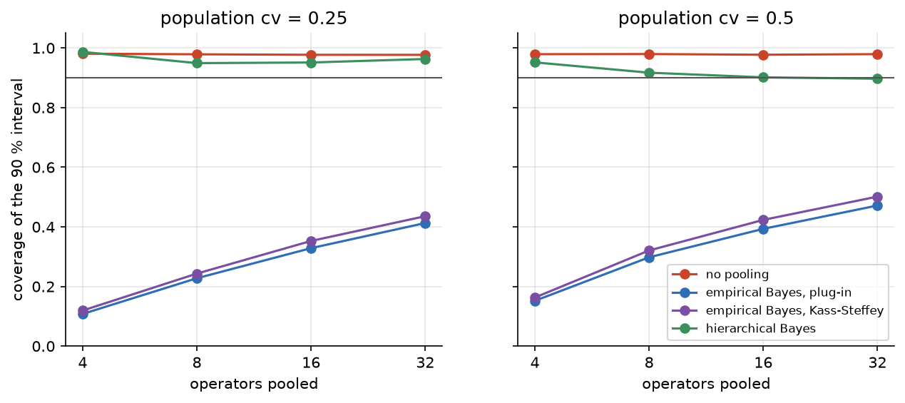
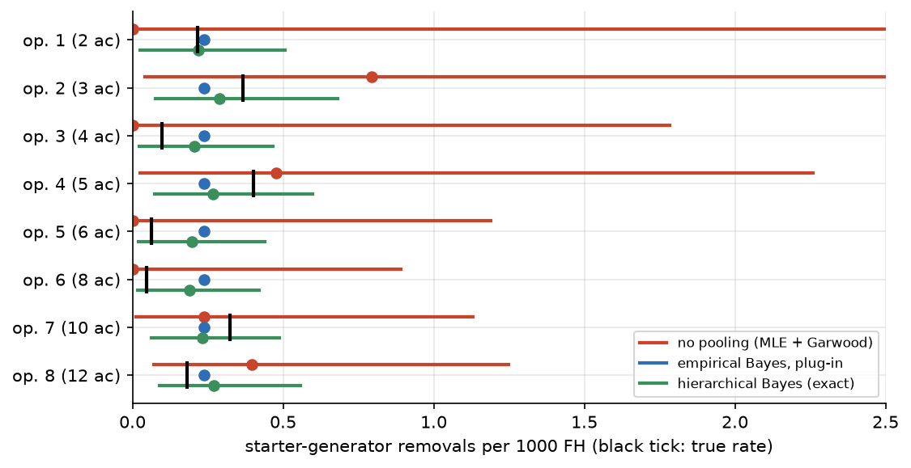

# Lesson 4 · Partial pooling, or how components lend each other strength

> Lesson 3 ended with a manufacturer whose operators looked identical to empirical Bayes.
> Every operator got the same estimate, with an interval of zero width. The data could not
> tell whether the operators differed, and empirical Bayes resolved that doubt by
> pretending it away. A hierarchical Bayesian model keeps the doubt: the spread between
> operators gets a prior, the data update it, and every operator's interval carries what is
> still unknown about the population. This lesson solves the model exactly and checks MCMC
> against the exact answer. On sparse data its intervals are honest where empirical Bayes's
> are not.

**Code:** [`src/smallfleet/hierarchical_model/`](../../src/smallfleet/hierarchical_model/) ·
**Tests:** [`tests/test_hierarchical_oracle.py`](../../tests/test_hierarchical_oracle.py),
[`tests/test_hierarchical_model.py`](../../tests/test_hierarchical_model.py) ·
**Results:** [`validation/results/hierarchical.md`](../../validation/results/hierarchical.md),
[`validation/results/hierarchical_mcmc.md`](../../validation/results/hierarchical_mcmc.md) ·
**Previous:** [Lesson 3](03-letting-the-data-choose-the-prior.md)

## Learning objectives

By the end of this lesson you should be able to:

1. Write the full hierarchical Gamma-Poisson model with a hyperprior, and explain why it
   differs from empirical Bayes.
2. Compute its posterior exactly by two-dimensional quadrature, and say why that is possible.
3. Run the same model in PyMC, read R-hat, effective sample size and divergences, and
   explain the hierarchical funnel and how marginalisation removes it.
4. Check the population assumption with a posterior predictive p-value, and check an
   inference engine by simulation-based calibration.
5. Read the operator study: what partial pooling buys over no pooling and over empirical
   Bayes.

---

## 1. One more level

Empirical Bayes estimates (α, β) and plugs the estimates in. The hierarchical model gives
them a prior instead:

```math
x_i \mid \lambda_i \sim \text{Poisson}(\lambda_i t_i), \qquad \lambda_i \mid \alpha, \beta \sim \text{Gamma}(\alpha, \beta), \qquad (\alpha, \beta) \sim p(\alpha, \beta) .
```

Every unit's posterior now averages over the population's uncertainty:

```math
p(\lambda_i \mid x) = \iint \text{Gamma}(\lambda_i \mid \alpha + x_i, \beta + t_i)\, p(\alpha, \beta \mid x)\, d\alpha\, d\beta .
```

When the data pin (α, β) down (66 plants, 361 events), this is almost the plug-in answer.
When they cannot (6 operators, 8 events), the average mixes "the operators are identical"
with "they differ a lot". The interval then widens exactly as much as that doubt requires.

### Hyperpriors

Two parameterisations are used in this course:

* **(α, β)**, as in NUREG/CR-6823 §8.3.4: $\alpha \sim \text{Exponential}(1)$,
  $\beta \sim \text{Gamma}(0.0625, 0.0625)$. Diffuse, with the means set from an earlier
  empirical Bayes fit.
* **(μ, cv)**, the project's default: the population mean $\mu = \alpha/\beta$ and the
  coefficient of variation $\text{cv} = 1/\sqrt\alpha$. These are the quantities an engineer
  has an opinion about. Here $\mu \sim \text{LogNormal}(\ln 0.2, 1)$ is centred on the large
  fleet's rate, but allowed to differ by a factor of $e^{1.645} \approx 5$ either way (90 %).
  And $\text{cv} \sim \text{HalfNormal}(1)$ puts its mode at zero spread (complete pooling)
  without forcing it.

The large fleet of Lesson 2 now informs the **population mean**, not each operator's rate,
and only weakly. That is a cleaner use of it than the power prior. The power prior needed a
hand-set discount; here the operators' own data decide how far the population sits from
the large fleet.

## 2. The exact solution

Conjugacy integrates every $\lambda_i$ out in closed form (Lesson 3). What remains is a
posterior over **two** numbers:

```math
p(\alpha, \beta \mid x) \propto p(\alpha, \beta) \prod_i \frac{\Gamma(\alpha + x_i)}{\Gamma(\alpha)\, x_i!} \left(\frac{\beta}{\beta + t_i}\right)^{\alpha} \left(\frac{t_i}{\beta + t_i}\right)^{x_i} .
```

Two dimensions can be integrated on a grid. `exact_posterior` uses the coordinates
$u = \ln\mu$ and $w = \ln\alpha$, in which the posterior is smooth and roughly elliptical.
Each hyperprior reports its density in those coordinates, Jacobian included:

```math
p(u, w) = p(\alpha, \beta)\, \alpha\beta \quad\text{for an } (\alpha, \beta) \text{ prior}, \qquad p(u, w) = p(\mu, \text{cv})\, \mu\, \frac{\text{cv}}{2} \quad\text{for a } (\mu, \text{cv}) \text{ prior} .
```

Two tests integrate each prior over the plane and get 1. Unit posteriors are then exact
mixtures of Gammas; their means, CDFs and quantiles are weighted sums over the grid.

### Making the oracle trustworthy

The first version of the oracle chose its grid from a Laplace approximation at the posterior
mode. It reproduced NUREG to three figures, and on sparse data it was **wrong by a factor of
8**: operator 1's mean came out 3.4 instead of 0.42. The test that compares it with MCMC
caught it. Two things had gone wrong:

1. With few events the posterior in $\ln\alpha$ has a long tail towards complete pooling
   ($\alpha \to \infty$, cv → 0), which a local Gaussian approximation cannot see. The grid
   now comes from a **wide scan** of $\ln\alpha$ from −12 to 46 (cv from about 400 down to
   $10^{-10}$), keeps every cell within $e^{-30}$ of the peak, and refines there.
2. $\ln\Gamma(\alpha + x) - \ln\Gamma(\alpha)$ cancels catastrophically when α is large. For
   integer counts it equals $\sum_{k<x} \ln(\alpha + k)$, and $\alpha\ln(\beta/(\beta + t))$ is
   computed as $-\alpha \cdot \text{log1p}(\mu t/\alpha)$.

The lesson is general: an "exact" method is only as exact as its numerics, and two
independent methods that should agree are the cheapest guard there is.

## 3. A published example, reproduced

NUREG/CR-6823 analysed Example 8.1 with WinBUGS: 1000 burn-in iterations, then 10 000 Gibbs
draws. The oracle computes the same posterior without sampling:

| quantity | NUREG (WinBUGS, §8.3.4.2 and Table 8.7) | exact |
|---|---|---|
| α: mean (sd) | 1.38 (0.30) | 1.373 (0.303) |
| β: mean (sd) | 1.21 (0.32) | 1.201 (0.314) |
| α: 90 % interval | (0.94, 1.93) | (0.946, 1.918) |
| corr(α, β) | 0.89 | 0.886 |
| Callaway | 4.97 (2.87, 7.51) | 4.998 (2.902, 7.617) |
| Wash. Nuclear 2 | 4.39 (3.01, 5.99) | 4.391 (3.012, 5.994) |

The differences are the Monte Carlo error of a 10 000-draw Gibbs run whose two
hyperparameters are correlated at 0.89. They are largest in the 95th percentiles, where
Monte Carlo is weakest. The tests accept 2.5 % and say why.

## 4. The same model in PyMC

For models the oracle cannot handle (more levels, covariates, other likelihoods), MCMC is
the tool. `model.py` builds the model two ways:

* **centred:** $\lambda_i$ are parameters, sampled with α and β;
* **marginal:** the $\lambda_i$ are integrated out, so NUTS samples only (μ, cv) or (α, β)
  under the negative-binomial likelihood. Each $\lambda_i$ is then drawn exactly from
  Gamma(α + x_i, β + t_i), once per posterior draw.

Three diagnostics decide whether a run can be trusted:

* **R-hat** compares the variance between chains with the variance within them. Above
  about 1.01, the chains have not mixed.
* **Effective sample size (ESS)**, bulk and tail, is the number of independent draws the
  autocorrelated chain is worth. The Monte Carlo standard error of a mean is
  $\text{sd}/\sqrt{\text{ESS}}$.
* **Divergences** are NUTS trajectories that failed numerically, usually in a region of high
  curvature. Even a few mean that part of the posterior may be under-explored.

From [`validation/results/hierarchical_mcmc.md`](../../validation/results/hierarchical_mcmc.md)
(4 chains × 2000 draws):

| data | form | max R-hat | min bulk ESS | divergences |
|---|---|---|---|---|
| NUREG Example 8.1 | marginal | 1.002 | 1498 | 0 |
| NUREG Example 8.1 | centred | 1.002 | 2620 | 0 |
| 6 sparse operators | marginal | 1.001 | 2315 | 0 |
| 6 sparse operators | centred | 1.010 | 420 | 61 |

All posterior means agree with the exact ones within one Monte Carlo standard error. The
sparse centred run is the **hierarchical funnel**. When cv is small, every $\lambda_i$ must
sit in a narrow band around μ; when cv is large, they can spread widely. The posterior is a
funnel in $(\text{cv}, \lambda)$ whose neck is too tight for one NUTS step size, and the
sampler diverges there. The data-rich case has no funnel, because 361 events pin cv away
from zero. There the centred form is even more efficient. Marginalising removes the funnel
by removing the λ's from the sampler. When a model allows it, that is the cleanest fix.
(Non-centring is the usual fix when it does not.)

That file is regenerated by the reproduce job but not byte-compared: NUTS trajectories
depend on floating-point details of the compiled model. What must hold on every machine
(agreement within 4 MCSE, R-hat below 1.01, ESS above 400, no divergences in the marginal
form) is a test.

## 5. Checking the model

**Is a Gamma population plausible?** The Pearson statistic

```math
X^2 = \sum_i \frac{(x_i - \hat\mu t_i)^2}{\hat\mu t_i}, \qquad \hat\mu = \frac{\sum x_i}{\sum t_i},
```

is 378.5 for Example 8.1, the handbook's value, on 65 degrees of freedom: overwhelming
evidence against one common rate. The posterior predictive p-value (Gelman, Meng & Stern,
1996) replicates the whole dataset from the fitted model: new plant rates from the
population, then new counts. It asks how often the replicated $X^2$ reaches 378.5. Under
complete pooling it never does (p = 0). Under the hierarchical model p is about 0.45, so the
model reproduces the observed spread.

**Is the inference engine right?** Simulation-based calibration (Cook, Gelman & Rubin, 2006)
draws (μ, cv) from the hyperprior, rates and counts from the model, and computes the
posterior CDF at the true rate. If the posterior is correct, those values are uniform. A
test runs 300 such worlds on sparse operator data and checks that the 90 % intervals cover
the truth 90 % of the time (within 3 standard errors), and that a Kolmogorov-Smirnov test does
not reject uniformity.

## 6. Results: sparse operators

The operator study of Lesson 3, rerun with hierarchical Bayes on the same draws (300
replicates per cell, exact posteriors). The hyperprior's mean is centred on 0.2, **20 % below
the true 0.25**, so the method is not being helped. Excerpt from
[`validation/results/hierarchical.md`](../../validation/results/hierarchical.md):

| cv | operators | method | RMSE / λ | 90 % coverage | width / λ |
|---|---|---|---|---|---|
| 0.5 | 4 | no pooling | 1.97 | 0.979 | 10.8 |
| | | empirical Bayes, Kass-Steffey | 1.61 | 0.163 | 0.004 |
| | | hierarchical Bayes | 1.10 | 0.952 | 2.52 |
| 0.5 | 32 | no pooling | 1.63 | 0.979 | 7.49 |
| | | empirical Bayes, Kass-Steffey | 0.98 | 0.501 | 1.09 |
| | | hierarchical Bayes | 0.92 | 0.897 | 1.81 |



1. **Honest intervals.** Hierarchical Bayes covers 0.90 to 0.99 in every cell. Empirical Bayes
   covers 0.11 to 0.50 on the same data.
2. **Useful intervals.** They are 3 to 4 times narrower than no pooling's.
3. **Better estimates.** It has the lowest RMSE in every cell.
4. **It degrades gracefully.** With 4 operators and a mis-centred hyperprior it is slightly
   conservative (0.95 to 0.99). It never becomes falsely confident.

### One draw

Eight operators of 2 to 12 business jets, five events in a year. Empirical Bayes finds zero
spread and gives every operator 0.238 with a zero-width interval. Hierarchical Bayes, from
the same data, gives each operator its own honest interval:



## 7. Worked example

Operator 6 in that draw flies 8 aircraft (3360 FH) and logs no removals. Its true rate is
0.046.

* **No pooling:** 0 with a 90 % interval (0, 0.892). True, but useless.
* **Empirical Bayes:** 0.238 (0.238, 0.238). Five times too high, and certain.
* **Hierarchical Bayes:** 0.188 (0.018, 0.419). The interval contains the truth. Its upper
  end, 0.42, is a usable "it is unlikely to be worse than" for an engineer.

Its posterior mean sits below the population mean (0.242) because it logged nothing in a
fair amount of flying. It sits well above 0 because one quiet year from eight aircraft is
weak evidence. That is partial pooling in one line.

## 8. Code walkthrough

```python
from smallfleet.hierarchical_model import MeanCVHyperprior, exact_posterior
from smallfleet.hierarchical_model.model import sample

prior = MeanCVHyperprior(mean_median=0.2, mean_log_sd=1.0, cv_scale=1.0)
post = exact_posterior(x, t, prior)  # t in thousands of FH
print(post.unit_mean(5), post.unit_interval(5, 0.90), post.hyper_moments()["cv_mean"])

mcmc = sample(x, t, prior, marginal=True, draws=2000, tune=2000, seed=1)
print(mcmc.rhat_max, mcmc.ess_bulk_min, mcmc.divergences, mcmc.unit_mean(5))
```

* `exact_posterior` scans, refines and trims the grid. Everything downstream is a weighted
  sum.
* `sample` runs NUTS on one core with a fixed seed and returns draws and diagnostics.
* `predictive_pvalue(rng, alpha_draws, beta_draws, x, t)` runs the dispersion check with draws
  from either engine (`post.sample_hyper` gives them from the oracle).

## Exercises

1. Derive the Jacobian $\mu \cdot \text{cv}/2$ for a prior on (μ, cv) expressed in
   $(\ln\mu, \ln\alpha)$.
2. In the marginal model, why are the drawn $\lambda_i$ exact draws from the joint
   posterior, and not an approximation?
3. The hyperprior's mean was 20 % low, yet coverage stayed at or above 90 %. Why does a
   mis-centred but wide hyperprior on μ cost so little?
4. On NUREG's data the centred model had a *higher* ESS than the marginal one. Why is the
   funnel absent there?
5. Empirical Bayes and hierarchical Bayes give nearly the same answers for Example 8.1 but
   very different ones for six sparse operators. State the condition under which the plug-in
   approximation is good.

### Solutions

1. $u = \ln\mu$ and $\text{cv} = \alpha^{-1/2} = e^{-w/2}$, so $|d\mu/du| = \mu$ and
   $|d \text{cv}/dw| = \text{cv}/2$. The map is a product of one-dimensional maps, so the
   Jacobian is the product $\mu \cdot \text{cv}/2$.
2. $p(\alpha, \beta, \lambda \mid x) = p(\alpha, \beta \mid x) \prod_i p(\lambda_i \mid \alpha, \beta, x_i)$.
   Sampling (α, β) from its marginal and then each $\lambda_i$ from its exact conditional
   Gamma is sampling from the joint. This is the composition method.
3. With $\text{sd}(\ln\mu) = 1$ the prior density barely changes over the gap of
   $\ln 1.25 = 0.22$ between 0.2 and 0.25, so it adds little bias. And whatever it cannot
   learn about μ stays in the posterior as width: each operator's interval mixes over every
   plausible population, so a wrong guess about the centre is paid for in width, not in
   coverage. Empirical Bayes has no such buffer, because it commits to one population.
4. 361 events give a sharp posterior for cv (sd about 0.1 around 0.87), far from zero. The
   neck of the funnel at small cv is never visited.
5. When the posterior of (α, β) is concentrated relative to how much the unit posteriors
   change across it: many units, many events, a spread clearly larger than Poisson noise.
   Kass and Steffey's first-order correction assumes exactly that.

## References

* C. L. Atwood et al., *Handbook of Parameter Estimation for Probabilistic Risk Assessment*,
  NUREG/CR-6823, U.S. Nuclear Regulatory Commission, 2003 (§8.3, Table 8.7).
* A. Gelman et al., *Bayesian Data Analysis*, 3rd ed., CRC Press, 2013 (hierarchical models,
  posterior predictive checks).
* A. Gelman, X.-L. Meng and H. Stern, "Posterior predictive assessment of model fitness via
  realized discrepancies," *Statistica Sinica* 6(4), 1996.
* S. R. Cook, A. Gelman and D. B. Rubin, "Validation of software for Bayesian models using
  posterior quantiles," *Journal of Computational and Graphical Statistics* 15(3), 2006.
* M. Betancourt and M. Girolami, "Hamiltonian Monte Carlo for hierarchical models," in
  *Current Trends in Bayesian Methodology with Applications*, CRC Press, 2015 (the funnel).
* A. Vehtari, A. Gelman, D. Simpson, B. Carpenter and P.-C. Bürkner, "Rank-normalization,
  folding, and localization: an improved R-hat for assessing convergence of MCMC," *Bayesian
  Analysis* 16(2), 2021.
* M. D. Hoffman and A. Gelman, "The No-U-Turn sampler," *Journal of Machine Learning Research*
  15, 2014.
