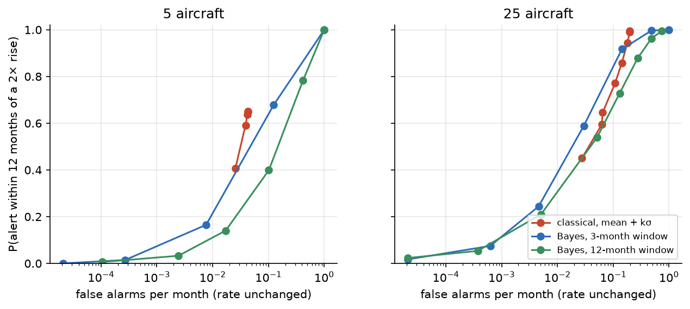

# Lesson 5 · An alert as a probability, not a line

> The classical alert level is a line drawn through last year's scatter. When this month's
> rate crosses it, the programme investigates. Lesson 1 showed what that line does on a
> small fleet: it is often zero, it alerts on single events, and changing it from 2σ to 3σ
> changes almost nothing. This lesson replaces the line with the question an engineer
> actually means: how probable is it that the true rate now exceeds what we can accept?
> It then measures, honestly, what that buys. It buys less detection than one might hope,
> because no rule can find information that is not in the data. What it does buy is a
> false-alarm rate that is known in advance, set on purpose, and the same whatever the
> fleet size.

**Code:** [`src/smallfleet/bayesian_alert_thresholds/`](../../src/smallfleet/bayesian_alert_thresholds/) ·
**Tests:** [`tests/test_bayesian_alerts.py`](../../tests/test_bayesian_alerts.py) ·
**Results:** [`validation/results/alerts.md`](../../validation/results/alerts.md) ·
**Previous:** [Lesson 4](04-partial-pooling.md)

## Learning objectives

By the end of this lesson you should be able to:

1. State a Bayesian alert rule as a posterior exceedance probability, and choose its three
   ingredients: target, window and probability threshold.
2. Show that, with a Gamma prior, the rule is a threshold on the window's event count, and
   compute its exact false-alarm rate.
3. Compare two alert rules fairly: on the same histories, at matched false-alarm rates.
4. Explain why on a very small fleet no rule can detect a doubling much better than "alert
   on an event".

---

## 1. The rule

An engineer has a **target** $\lambda^\ast$, the highest rate the fleet should run at (a
contracted MTBUR, a design value, or the nominal rate times a margin). Each month, update
the prior with the last $w$ months of data and ask:

```math
\text{alert in month } j \iff P(\lambda > \lambda^\ast \mid \text{prior},\ y_{j-w+1}, \dots, y_j) > p^\ast .
```

With a Gamma(α, β) prior and the window's count $Y_w$ in exposure $T_w$, the probability is a
Gamma survival function:

```math
P(\lambda > \lambda^\ast \mid Y_w) = Q\left(\alpha + Y_w,\ \lambda^\ast (\beta + T_w)\right),
```

where $Q$ is the regularised upper incomplete gamma function (`scipy.special.gammaincc`).
It needs no table and no chart reading, and the alert carries a number a reviewer can
weigh: "P(rate above target) = 0.69".

**Three choices, each explicit:**

* the **target** $\lambda^\ast$: here 1.5 times the nominal 0.25, so 0.375 per 1000 FH (an
  illustrative acceptance limit);
* the **window** $w$: how much history counts. Short windows react quickly; long ones are
  steadier. A geometric forgetting factor (`discounted_exceedance`) is the smooth version;
* the **threshold** $p^\ast$: how sure you must be before acting. Lesson 6 derives it from
  the costs of the two kinds of error.

## 2. The rule is a count threshold, so its false-alarm rate is exact

$P(\lambda > \lambda^\ast \mid Y_w)$ rises with $Y_w$: more events give a posterior shifted
to the right (a Hypothesis test checks this for any count, exposure and target). So for a
fixed window exposure there is a smallest count $c$ that crosses $p^\ast$, and

```math
\text{alert} \iff Y_w \ge c, \qquad P(\text{false alarm}) = P(Y_w \ge c \mid \lambda_0) = 1 - F_{\text{Poisson}}(c - 1;\ \lambda_0 T_w)
```

at the nominal rate $\lambda_0$. `alert_count_threshold` finds $c$ by bisection;
`window_false_alarm_rate` returns the tail. A test checks it against the same rule run on
simulated histories.

Compare the classical rule. Its level depends on a 12-month baseline that is itself random:
degenerate in 59 % of years on five aircraft. Its false-alarm rate has no formula, and Lesson 1
measured it from 3 to 11 % depending on fleet size. Nobody chose those numbers.

## 3. A fair comparison

[`validation/alerts.py`](../../validation/alerts.py) simulates 4000 histories per fleet
size: 12 baseline months at the nominal rate, then 12 monitored months either unchanged or
at **twice** the rate. Every rule sees the same histories. The Bayesian prior is the large
fleet's rate counted as 10 000 FH: Gamma(2.5, 10).

Comparing rules at their default settings is misleading, because one can always detect more
by alerting more. The fair comparison sweeps each rule's threshold (k for the classical
rule, p* for the Bayesian one) and compares **detection at matched false-alarm rates**.



**On 25 aircraft** the 3-month Bayesian window lies above the classical curve everywhere. At
about 3 % false alarms per month, it detects the doubling within a year 59 % of the time
against 45 % for mean + kσ. Its exact false-alarm rate is 0.0290; Monte Carlo gives 0.030.

**On 5 aircraft** the classical rule is the single red cluster near 4 %. Mean + 2σ and mean + 3σ
give 0.042 and 0.039 false alarms, and 0.64 and 0.59 detection. The baseline is usually all
zeros, so the rule is "alert on any event", whatever k says. At that one point it detects a
little more than the Bayesian curves. But it has no knob: an operator who wants fewer false
alarms cannot get them by raising k. The Bayesian rule offers the whole curve: 0.8 % false
alarms with 17 % detection, or 12 % with 68 %, chosen in advance.

### Why nothing does much better on five aircraft

At the nominal rate the fleet expects 0.044 events a month; doubled, 0.088. A year of the
doubled rate produces about one event: $P(\text{at least one in 12 months}) = 1 - e^{-12 \times 0.0875} = 0.65$.
"Alert on any event" catches 0.637, almost exactly that. Any rule that waits for more
evidence than one event will detect less. Any rule that does not wait will alert on the
nominal fleet's events too, which happen in 4 % of months. This is an information limit,
not a method limit. On a fleet this small the useful questions are the ones Lessons 2 to 4
answered (what is the rate, with what uncertainty, borrowing from where?), not "has it just
changed?".

## 4. Results at default settings

From [`validation/results/alerts.md`](../../validation/results/alerts.md), p* = 0.5 ("more
likely than not above target"):

| aircraft | rule | false alarms per month | P(detect within 12 months) | median delay |
|---|---|---|---|---|
| 5 | mean + 2σ | 0.042 | 0.637 | 5 |
| 5 | Bayes, 6-month window | 0.029 | 0.27 | 6 |
| 25 | mean + 2σ | 0.108 | 0.771 | 3 |
| 25 | Bayes, 3-month window | 0.030 | 0.588 | 5 |
| 100 | mean + 2σ | 0.079 | 0.905 | 3 |
| 100 | Bayes, 3-month window | 0.054 | 0.951 | 3 |

On 100 aircraft the Bayesian 3-month rule detects more *and* alerts less than mean + 2σ.
On 25 it trades some detection for a false-alarm rate three and a half times lower. On 5,
see Section 3.

## 5. Worked example

Five business jets, a 6-month window ($T_w = 1050$ FH), prior Gamma(2.5, 10), target 0.375,
$p^\ast = 0.5$.

| events in the window | posterior | mean | P(λ > 0.375) | alert? |
|---|---|---|---|---|
| 0 | Gamma(2.5, 11.05) | 0.226 | 0.141 | no |
| 1 | Gamma(3.5, 11.05) | 0.317 | 0.308 | no |
| 2 | Gamma(4.5, 11.05) | 0.407 | 0.505 | yes |
| 3 | Gamma(5.5, 11.05) | 0.498 | 0.687 | yes |

So $c = 2$: two removals in six months. At the nominal rate the window expects 0.26 events,
and $P(Y \ge 2) = 0.029$, the exact false-alarm rate. At twice the rate it is 0.098 per month.
Note that the prior alone already gives P(λ > 0.375) = 0.19: the large fleet is not certain
that the small fleet is within target either.

## 6. Code walkthrough

```python
from smallfleet.bayesian_alert_thresholds import (
    alert_count_threshold,
    bayes_window_rule,
    window_exceedance,
    window_false_alarm_rate,
)
from smallfleet.bayesian_point_estimation import GammaRate

prior = GammaRate(2.5, 10.0)
probs = window_exceedance(prior, counts, exposure_fh, target=0.375, window=6)
alerts = probs > 0.5
c = alert_count_threshold(prior, 6 * 175.0, 0.375, 0.5)  # the equivalent count rule
print(window_false_alarm_rate(prior, 0.25, 175.0, 6, 0.375, 0.5))  # exact
```

* `window_exceedance` uses cumulative sums, so all months are scored in one vectorised call.
* `characteristics(histories, rule)` runs any rule (a function from counts and exposure to
  flags) on the same simulated histories. That is how the classical and Bayesian rules are
  compared, paired.

## Exercises

1. Show that $P(\lambda > \lambda^\ast \mid Y)$ is non-decreasing in $Y$ for a Gamma prior.
   (Hint: Gamma(a + 1, b) is the distribution of a Gamma(a, b) plus an independent
   exponential.)
2. For the worked example, what is the false-alarm rate if $p^\ast = 0.3$? And the detection
   probability per month at twice the rate?
3. Why does raising k from 2 to 3 barely change the classical rule on five aircraft?
4. A fleet of 25 aircraft wants at most one false alarm in two years for this component. Which
   rule and setting from the results table would you choose, and what detection does it
   give?
5. Explain, without equations, why a long window (12 months) detects *less* than a short one
   at the same false-alarm rate on 25 aircraft.

### Solutions

1. If $X \sim \text{Gamma}(a, b)$ and $E \sim \text{Exp}(b)$ are independent, then
   $X + E \sim \text{Gamma}(a + 1, b)$, and $X + E \ge X$. So
   $P(X + E > \lambda^\ast) \ge P(X > \lambda^\ast)$. The posterior after one more event is
   $\text{Gamma}(\alpha + Y + 1, \beta + T)$, the same construction.
2. With $p^\ast = 0.3$, $c = 1$, since $P(\lambda > 0.375 \mid 1) = 0.308 > 0.3$. The
   false-alarm rate is $1 - e^{-0.2625} = 0.231$ per month; detection per month at twice the
   rate is $1 - e^{-0.525} = 0.41$.
3. In about 59 % of years the baseline is all zeros, so σ = 0 and the level is 0 for any k.
   In most other years it holds one event, and any later event exceeds both levels.
4. One false alarm in 24 months is about 0.04 per month. On 25 aircraft the Bayesian 3-month
   rule at p* = 0.5 gives 0.030 false alarms with 0.588 detection; mean + 3σ gives 0.062
   with 0.594.
5. A doubling that started three months ago fills a 3-month window entirely with new data.
   In a 12-month window it is diluted by nine months of the old rate, so the count needed
   for the same false-alarm rate is reached later or not at all within the year.

## References

* FAA, Advisory Circular 120-17B, §4.2.1 (purpose of an alert level), 2018.
* C. L. Atwood et al., NUREG/CR-6823, 2003, §6.2.2 (posterior percentiles of a Gamma).
* M. West and J. Harrison, *Bayesian Forecasting and Dynamic Models*, 2nd ed., Springer, 1997
  (discounted Gamma-Poisson models).
* D. C. Montgomery, *Introduction to Statistical Quality Control*, 7th ed., Wiley, 2012 (the
  operating-characteristic view of control charts).
* M. S. Hamada, A. G. Wilson, C. S. Reese and H. F. Martz, *Bayesian Reliability*, Springer,
  2008.
