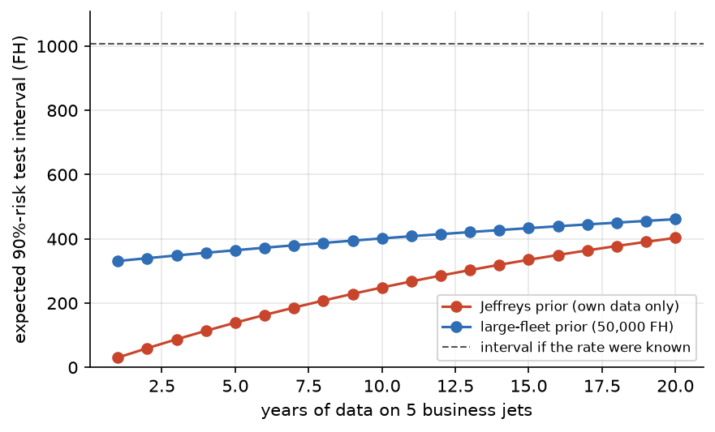

# Lesson 6 · Deciding under uncertainty

> A posterior is not a decision. Lesson 5 alerted when P(rate above target) exceeded p*, but
> where does p* come from? And what about a decision that cannot wait for an alert, such as
> how often to test a protective device whose failures stay hidden until someone looks?
> Bayesian decision theory answers both with one recipe: list the actions, put a cost on
> each outcome, and choose the action with the smallest expected cost under the posterior.
> This lesson applies it to alerts, to waiting for more data, and to a test interval. It
> shows that on a small fleet the price of uncertainty is paid in flight hours.

**Code:** [`src/smallfleet/decision_theory/`](../../src/smallfleet/decision_theory/) ·
**Data:** [`decision_parameters.csv`](../../src/smallfleet/data/decision_parameters.csv) ·
**Tests:** [`tests/test_decision_theory.py`](../../tests/test_decision_theory.py) ·
**Results:** [`validation/results/decisions.md`](../../validation/results/decisions.md) ·
**Previous:** [Lesson 5](05-an-alert-as-a-probability.md)

## Learning objectives

By the end of this lesson you should be able to:

1. Derive the Bayes-optimal alert threshold from the costs of a false alarm and of a missed
   degradation.
2. Compute the expected value of sample information (EVSI) of waiting one more month, and
   decide whether waiting is worth its cost.
3. Derive the mean unavailability of a hidden failure under periodic testing, and the
   classical failure-finding interval.
4. Choose a test interval from a whole posterior, by expected unavailability or by risk, and
   explain why the two differ.
5. Read "what data are worth" in flight hours of test interval.

---

## 1. The alert threshold is a cost ratio

Two states: the rate is above target ($\lambda > \lambda^\ast$) or not. Two actions:
investigate now, or not. Two costs: $c_{FA}$ for an investigation that finds nothing, and
$c_{miss}$ for a month of a degraded component left alone. With $p = P(\lambda > \lambda^\ast \mid \text{data})$:

```math
E[\text{loss} \mid \text{investigate}] = c_{FA}(1 - p), \qquad E[\text{loss} \mid \text{wait}] = c_{miss}\, p .
```

Investigate exactly when the first is smaller:

```math
p > p^\ast = \frac{c_{FA}}{c_{FA} + c_{miss}} .
```

A test checks the switch point by brute force on a grid of 100 001 probabilities. If a
missed month costs four investigations (the labelled assumption here), $p^\ast = 0.2$. The
threshold is no longer a convention like 2σ: it states what the operator believes the
errors cost, and anyone can challenge that belief.

From [`validation/results/decisions.md`](../../validation/results/decisions.md), on 25
business jets with Lesson 5's prior and a 3-month window:

| $c_{miss}/c_{FA}$ | $p^\ast$ | alert at events in 3 months | false alarms per month | alert probability per month at 2× rate |
|---|---|---|---|---|
| 1 | 0.5 | 3 | 0.029 | 0.146 |
| 4 | 0.2 | 1 | 0.481 | 0.731 |
| 19 | 0.05 | 0 | 1 | 1 |

Read the last two rows carefully. When misses are expensive, the optimal policy investigates
on a single event, or always. The **prior alone** already gives P(λ > 0.375) = 0.19: the
large fleet cannot vouch for the small one. So with $p^\ast = 0.05$, doing nothing is never
optimal until data narrow the posterior. Decision theory does not hide uncertainty; it
prices it. The way out of "always investigate" is more information (Lessons 3 and 4), not a
higher threshold.

## 2. Should we wait a month?

Deciding now uses today's posterior. Waiting a month buys one more month of data, then
decides optimally. **Preposterior analysis** values that before seeing the data. Next
month's count $\tilde y$ has the negative-binomial predictive distribution (Lesson 2), and
each possible count updates $p$ to $p'(\tilde y)$:

```math
\text{EVSI} = \min\left\{c_{FA}(1-p),\ c_{miss}p\right\} - E_{\tilde y}\left[\min\left\{c_{FA}(1-p'),\ c_{miss}p'\right\}\right] \ \ge\ 0 .
```

EVSI cannot be negative: the minimum of an average is at least the average of the minima,
and $E_{\tilde y}[p'] = p$ (a test checks this martingale property exactly). Waiting is worth
it when EVSI exceeds the expected cost of the delay, $c_{delay} \cdot p$.

| aircraft | events in last 3 months | P(λ > target) | best now | EVSI | delay cost |
|---|---|---|---|---|---|
| 5 | 0 | 0.162 | no action | 0.0275 | 0.0811 |
| 5 | 1 | 0.342 | investigate | 0 | 0.171 |
| 25 | 0 | 0.092 | no action | 0.0137 | 0.0459 |
| 25 | 1 | 0.221 | investigate | 0.0728 | 0.110 |

EVSI is zero whenever no possible count next month could change the decision: on five
aircraft, after one event, even a quiet month leaves $p' > 0.2$. It is largest near the
threshold (25 aircraft, one event, $p = 0.22$), where one month can tip the balance. Even
there it does not pay for the delay at these costs. A reliability engineer who "waits for
more data" by habit is making this calculation implicitly. Here it is explicit.

## 3. A test interval for a hidden failure

A protective device (a fire detector, a standby pump) fails at rate λ, and nobody knows
until the next test, every τ hours. If a failure happens at a uniformly random point of the
interval, the mean fraction of time the device is failed and undetected is

```math
U(\lambda, \tau) = \frac{1}{\tau}\int_0^\tau \left(1 - e^{-\lambda s}\right) ds = 1 - \frac{1 - e^{-\lambda\tau}}{\lambda\tau} \approx \frac{\lambda\tau}{2} .
```

Setting $U = U^\ast$ gives the classical **failure-finding interval**, $\tau \approx 2U^\ast/\lambda$
(Moubray, 1997). With the illustrative values $\lambda = 0.02$ per 1000 FH and $U^\ast = 0.01$,
the exact interval is 1007 FH; the approximation gives 1000.

But λ is not known. Three ways to choose τ:

* **plug-in:** use a point estimate. With zero failures the MLE is 0 and τ = ∞, which is
  absurd but is exactly what the formula says;
* **expected unavailability:** the longest τ with $E[U(\lambda, \tau)] \le U^\ast$. For a
  Gamma(a, b) posterior, using $E[1/\lambda] = b/(a-1)$ and
  $E[e^{-\lambda\tau}/\lambda] = \frac{b}{a-1}\left(\frac{b}{b+\tau}\right)^{a-1}$:

  ```math
  E[U] = 1 - \frac{b}{(a-1)\tau}\left[1 - \left(\frac{b}{b+\tau}\right)^{a-1}\right], \qquad a > 1 ;
  ```

* **risk-based:** the longest τ with $P(U(\lambda, \tau) > U^\ast) \le 0.1$. Because $U$
  rises with λ, this is the known-rate interval at the posterior 90th percentile of λ.

$U$ is concave in λ, so Jensen's inequality gives $E[U(\lambda)] \le U(E[\lambda])$. The
expected-unavailability interval is therefore *at least* the plug-in one at the posterior
mean, while the risk-based interval is shorter. A test checks this ordering.

### Results

Five business jets (2100 FH a year). The large-fleet prior counts the large fleet's rate as
50 000 FH: Gamma(1.5, 50).

| years | failures found | plug-in MLE | Jeffreys, 90 % risk | prior, expected U | prior, 90 % risk |
|---|---|---|---|---|---|
| 3 | 0 | ∞ | 94 | 759 | 363 |
| 3 | 1 | 127 | 41 | 455 | 245 |
| 10 | 0 | ∞ | 313 | 957 | 457 |
| 10 | 4 | 106 | 58 | 260 | 166 |



The figure averages the risk-based interval over the Poisson outcomes at the true rate. With
its own data only (Jeffreys), a five-jet operator starts at 31 FH and reaches 403 FH after
twenty years. With the large fleet's experience it starts at 331 FH. The gap to 1007 FH is
**the price of not knowing the rate**, paid in extra tests. Pooling information is worth
hundreds of flight hours of interval.

> **A caveat you can see in the numbers.** Gamma(1.5, 50) has mean 0.03, not the large
> fleet's 0.02. The power prior's Jeffreys starting point adds half an event, and over 50 000
> FH that is 0.01 per 1000 FH. Lesson 2 met the same effect on the fuel boost pump. It makes
> these intervals conservative. A larger equivalent exposure, or a hierarchical population
> mean (Lesson 4), removes it.

## 4. Worked example

Three years on five jets, no hidden failures found ($t = 6.3$ thousand FH), prior
Gamma(1.5, 50). The posterior is Gamma(1.5, 56.3), with mean 0.0266 and 90th percentile
0.0555.

* Plug-in at the posterior mean: $\tau = 756$ FH.
* Expected unavailability: $\tau = 759$ FH, slightly longer, as Jensen predicts.
* 90 % risk: $\tau$ at λ = 0.0555, so 363 FH.

The engineer's choice between 759 and 363 FH is the choice between "on average we meet the
target" and "we are 90 % sure we meet it". It is a policy choice, and decision theory makes
it visible instead of hiding it in a point estimate.

## 5. Code walkthrough

```python
from smallfleet.bayesian_point_estimation import GammaRate
from smallfleet.decision_theory import (
    AlertCosts,
    bayes_threshold,
    interval_for_expected_unavailability,
    interval_for_risk,
    value_of_waiting,
)

costs = AlertCosts(false_alarm=1.0, missed=4.0, delay=0.5)
print(bayes_threshold(costs))  # 0.2
post = GammaRate(2.5, 10.0).update(1, 3 * 875.0)
print(value_of_waiting(post, target=0.375, month_fh=875.0, costs=costs))

device = GammaRate(1.5, 50.0).update(0, 6300.0)
print(interval_for_expected_unavailability(device, 0.01), interval_for_risk(device, 0.01, 0.9))
```

## Exercises

1. Show that adding a cost $c_I$ to *every* investigation (needed or not) and a cost
   $c_{miss}$ to missing gives the threshold $p^\ast = c_I/c_{miss}$, and relate it to the
   two-cost form.
2. Derive $E[e^{-\lambda\tau}/\lambda]$ for $\lambda \sim \text{Gamma}(a, b)$.
3. Why must $a > 1$ for the expected-unavailability formula? What happens with a Jeffreys
   posterior and zero failures?
4. In Section 2, why is EVSI exactly zero for five aircraft with two events in three months?
5. A regulator accepts "on average" (expected U). The operator's insurer wants "90 % sure"
   (risk-based). Using the worked example, what does the insurer's requirement cost in
   tests per 10 000 FH?

### Solutions

1. Investigate: $c_I$. Wait: $c_{miss}p$. Investigate when $p > c_I/c_{miss}$. With
   $c_{FA} = c_I$ and a miss cost of $c_{miss} - c_I$ net of the investigation it would have
   needed anyway, $c_{FA}/(c_{FA} + c_{miss} - c_I) = c_I/c_{miss}$: the same rule.
2. $\int_0^\infty \frac{b^a}{\Gamma(a)}\lambda^{a-2}e^{-(b+\tau)\lambda}d\lambda = \frac{b^a \Gamma(a-1)}{\Gamma(a)(b+\tau)^{a-1}} = \frac{b}{a-1}\left(\frac{b}{b+\tau}\right)^{a-1}$.
3. The formula uses $E[1/\lambda]$, which is infinite for $a \le 1$: the posterior puts too
   much mass near λ = 0. With Jeffreys and zero failures, $a = 0.5$, and the expected
   unavailability of a long interval is driven by a tail that the data cannot rule out. The
   risk-based rule still works, because it needs only a quantile.
4. $p = 0.545$ now. Even a quiet month gives $p' > 0.2$, so the best action is "investigate"
   whatever happens next month. Information that cannot change a decision is worth nothing.
5. $10000/363 - 10000/759 = 27.5 - 13.2 \approx 14$ extra tests per 10 000 FH.

## References

* J. O. Berger, *Statistical Decision Theory and Bayesian Analysis*, 2nd ed., Springer, 1985
  (expected loss, preposterior analysis).
* H. Raiffa and R. Schlaifer, *Applied Statistical Decision Theory*, Harvard University,
  1961 (the value of sample information).
* J. Moubray, *Reliability-Centred Maintenance*, 2nd ed., Butterworth-Heinemann, 1997
  (failure-finding intervals).
* M. Rausand and A. Høyland, *System Reliability Theory*, 2nd ed., Wiley, 2004 (mean
  unavailability of periodically tested components).
* M. S. Hamada, A. G. Wilson, C. S. Reese and H. F. Martz, *Bayesian Reliability*, Springer,
  2008.
