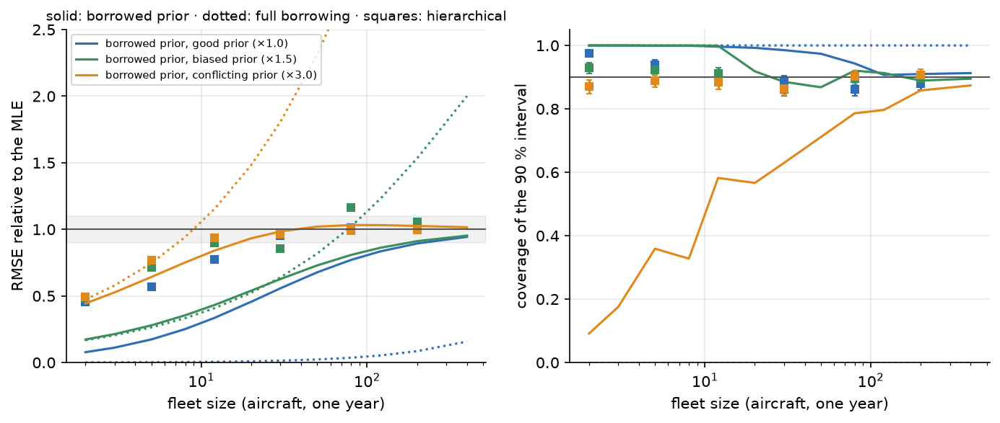

# Lesson 7 · How big is a big fleet?

> Every lesson so far compared methods at one or two fleet sizes. This one sweeps from 2
> aircraft to 400, and asks two questions the PLAN set at the start: at what fleet size do
> the classical and Bayesian answers converge, and where does borrowing strength help most?
> The answer depends on one more thing than fleet size: how right the borrowed information
> is. So the sweep runs three times, with a prior that is right, 50 % off, and three times
> off.

**Code:** [`src/smallfleet/simulation_study/`](../../src/smallfleet/simulation_study/) ·
**Tests:** [`tests/test_simulation_study.py`](../../tests/test_simulation_study.py) ·
**Results:** [`validation/results/simulation_study.md`](../../validation/results/simulation_study.md) ·
**Previous:** [Lesson 6](06-deciding-under-uncertainty.md)

## Learning objectives

By the end of this lesson you should be able to:

1. Derive the RMSE of a conjugate estimator relative to the MLE, and the fleet size at which
   they converge.
2. Separate the two costs of borrowing: bias when the prior is wrong, and overconfidence
   when it is worth too much.
3. Explain why hierarchical pooling across operators is robust where a single borrowed
   prior is not.
4. Read a simulation study's results with their Monte Carlo error, and know which numbers
   are exact.

---

## 1. The algebra of convergence

With a Gamma(α, β) prior and exposure $t$, the posterior mean is
$w\mu_0 + (1 - w)\hat\lambda$ with $w = \beta/(\beta + t)$ (Lesson 2). Its error has a bias
and a variance:

```math
\text{MSE} = w^2(\mu_0 - \lambda)^2 + (1 - w)^2\frac{\lambda}{t}, \qquad \text{MSE}_{\text{MLE}} = \frac{\lambda}{t} .
```

* **A correct prior** ($\mu_0 = \lambda$): the RMSE ratio is exactly $1 - w = t/(\beta + t)$. A
  test checks this to $10^{-9}$. The two estimators are within 10 % once $t \ge 9\beta$. For a
  prior worth 10 000 FH that is 90 000 FH, about 214 aircraft-years of business-jet flying.
  **On this measure no business-jet fleet is big.**
* **A biased prior:** the bias term $w^2(\mu_0 - \lambda)^2$ does not shrink with the prior's
  confidence; it grows with it. Borrowing still wins while that term is smaller than what
  it saves in variance, $(1 - (1 - w)^2)\lambda/t$.

Fleet size enters only through $t$, and the prior only through $\beta$ and $\mu_0 - \lambda$.
The whole study is these two lines, evaluated exactly.

## 2. The single-fleet sweep

[`validation/simulation_study.py`](../../validation/simulation_study.py) computes the exact
RMSE, coverage and width (sums over the Poisson count, no simulation error) for fleets of 2
to 400 business jets observed for a year. The large fleet's rate is 0.2 per 1000 FH; the
small fleet's true rate is 1.0, 1.5 or 3.0 times that. The **borrowed prior** has the large
fleet's mean and is worth 10 000 FH; **full borrowing** counts all 900 000 FH.

| prior quality | RMSE ratio at 5 aircraft | best ratio | coverage at 5, borrowed | coverage at 5, full | ratio within 10 % from |
|---|---|---|---|---|---|
| good (×1.0) | 0.174 | 0.077 at 2 | 0.999 | 1 | 400 aircraft |
| biased (×1.5) | 0.279 | 0.173 at 2 | 1 | 0 | 200 aircraft |
| conflicting (×3.0) | 0.642 | 0.443 at 2 | 0.359 | 0 | 20 aircraft |



Four findings:

1. **Borrowing helps most where data are fewest.** On 2 to 5 aircraft even a prior three times
   off cuts the RMSE by a third or more, because the MLE there is mostly noise.
2. **A good prior keeps helping far beyond any business-jet fleet.** With the prior right,
   the estimates converge only at about 400 aircraft-years of data.
3. **A wrong prior stops helping sooner, and lies about it.** With the prior three times
   off, the RMSE gain disappears by 20 aircraft. Worse, the intervals cover only 36 % at 5
   aircraft (dropping to 9 % at 2): the estimate is better than the MLE on average and
   **overconfident**. Lesson 2 showed that the conflict check cannot see this on a small
   fleet.
4. **Full borrowing is a bet, not a method.** When the prior is exactly right it is nearly
   perfect (coverage 1, RMSE ratio 0.002). That is by construction here, since the "large
   fleet" carries no noise. When it is 50 % off, coverage is 0 at every size, and the RMSE
   ends up worse than the MLE's from about 80 aircraft.

## 3. The hierarchical arm

Borrowing from a *different* fleet needs a judgement about how different it is. Pooling
*several operators of the same type* (Lessons 3 and 4) lets the data make that judgement.
The study gives 8 operators of each size rates that vary with cv 0.5 around the true mean,
and fits the exact hierarchical posterior with its hyperprior centred on the large fleet
(μ ~ LogNormal(ln 0.2, 1)), right or wrong. Seeded Monte Carlo, 120 replicates, ± one
standard error:

| prior quality | aircraft per operator | RMSE / λ, MLE | RMSE / λ, hierarchical | coverage, hierarchical |
|---|---|---|---|---|
| good | 2 | 2.52 ± 0.15 | 1.15 ± 0.07 | 0.976 ± 0.005 |
| good | 5 | 1.62 ± 0.07 | 0.92 ± 0.05 | 0.940 ± 0.008 |
| conflicting | 2 | 1.61 ± 0.12 | 0.80 ± 0.06 | 0.870 ± 0.011 |
| conflicting | 5 | 0.98 ± 0.03 | 0.75 ± 0.09 | 0.889 ± 0.010 |
| conflicting | 200 | 0.153 ± 0.004 | 0.153 ± 0.004 | 0.907 ± 0.009 |

The hierarchical estimate halves the RMSE on 2-aircraft operators **whatever the hyperprior
says**, and keeps coverage between 0.86 and 0.98. A hyperprior three times off costs it
little, because eight operators' data overrule a weak hyperprior on the population mean.
That robustness is the reason to prefer pooling across one's own type over borrowing from
another.

At 30 to 80 aircraft per operator, coverage dips to 0.86 to 0.88, two to four standard errors
below nominal. Two checks show it is real but small. Refining the oracle's grid from 121 to
241 points changes nothing. Plugging in the *true* population on the same draws gives 0.898.
The shortfall is the price of estimating the population's spread from eight operators: a
frequentist property of a Bayesian procedure, not a bug.

## 4. Reading a simulation study honestly

* **Exact or Monte Carlo?** The single-fleet grid is exact: a change in the third decimal is a
  real change. The hierarchical arm is Monte Carlo: compare numbers only within their
  standard errors.
* **Which truth?** Each number is conditional on a true rate, a prior and an exposure that
  are illustrative assumptions. The *shape* of the results (the two lines of Section 1) does
  not depend on them; the crossover sizes do.
* **Which question?** "Converges" here means RMSE within 10 %. A coverage criterion gives
  different sizes, and the right criterion depends on the decision the estimate feeds
  (Lesson 6).

## 5. Worked example

A 5-aircraft operator (2100 FH a year), large fleet at 0.2, true rate 0.3 (biased prior).
The borrowed prior Gamma(2, 10) gives $w = 10/12.1 = 0.826$.

* Bias: $0.826 \times (0.2 - 0.3) = -0.083$.
* Standard deviation: $(1 - 0.826)\sqrt{0.3/2.1} = 0.174 \times 0.378 = 0.066$.
* RMSE $= \sqrt{0.083^2 + 0.066^2} = 0.106$, against the MLE's $0.378$: a ratio of 0.28,
  the table's value. It is three-quarters bias, but still far better than three-quarters
  noise.

## 6. Code walkthrough

```python
from smallfleet.simulation_study import (
    convergence_size,
    operator_pooling_point,
    single_fleet_point,
)

pts = [single_fleet_point(n, 0.3, 0.2, 35.0, 12, 10_000.0, 900_000.0) for n in (2, 5, 20, 200)]
print(convergence_size(pts, "borrowed prior"))  # smallest size within 10 % of the MLE
q = operator_pooling_point(rng, 5, 8, 0.3, 0.5, 0.2, 35.0, 12, replicates=120)
print(q.rmse["hierarchical Bayes"], q.coverage["hierarchical Bayes"])  # value ± se
```

## Exercises

1. For a correct prior worth $E$ flight hours, find the fleet size (aircraft-years) at which
   the borrowed estimate's RMSE is half the MLE's.
2. Show that for a biased prior the RMSE ratio is minimised at $t = 0$ only if the bias is
   small enough. What happens to the ratio as $t \to 0$?
3. Full borrowing in the "good prior" case has coverage 1 at every size. Would it, if the
   large fleet's rate were itself estimated from 900 000 FH of simulated data? (Lesson 2's
   fuel pump.)
4. Why does the hierarchical arm's advantage vanish at 200 aircraft per operator?
5. Name one decision for which coverage matters more than RMSE, and one for which the
   reverse holds.

### Solutions

1. Ratio $= t/(\beta + t) = 1/2$ when $t = \beta$: the small fleet must have flown as much as
   the prior is worth. For 10 000 FH that is about 24 aircraft-years at 420 FH.
2. As $t \to 0$, $w \to 1$: the RMSE tends to $|\mu_0 - \lambda|$ and the MLE's to infinity,
   so the ratio tends to 0 for any finite bias. Borrowing always wins with no data; it loses
   only when the data are plentiful enough to beat the bias.
3. No. The large fleet's estimate carries sampling error of order $\sqrt{0.2/900} = 0.015$.
   With 900 000 FH the prior's interval is about that wide, so it misses the truth about
   10 % of the time from the large fleet's noise alone. That is what happened to the fuel
   pump.
4. With 200 aircraft per operator each operator's own data pin its rate down (about 17 events
   a year), so the weight on the population goes to zero and the posterior mean approaches
   the MLE.
5. A safety-critical test interval (Lesson 6, risk-based) needs honest coverage. A spares
   budget summed over many components cares about average error, so RMSE.

## References

* C. L. Atwood et al., NUREG/CR-6823, 2003, §6.2.2.5 (comparison of priors).
* A. Gelman et al., *Bayesian Data Analysis*, 3rd ed., CRC Press, 2013, ch. 5 (hierarchical
  models and the frequentist evaluation of Bayesian procedures).
* T. P. Morris, I. R. White and M. J. Crowther, "Using simulation studies to evaluate
  statistical methods," *Statistics in Medicine* 38(11), 2019 (design and Monte Carlo
  standard errors).
* B. Efron, *Large-Scale Inference*, Cambridge University Press, 2010 (shrinkage and its
  frequentist properties).
