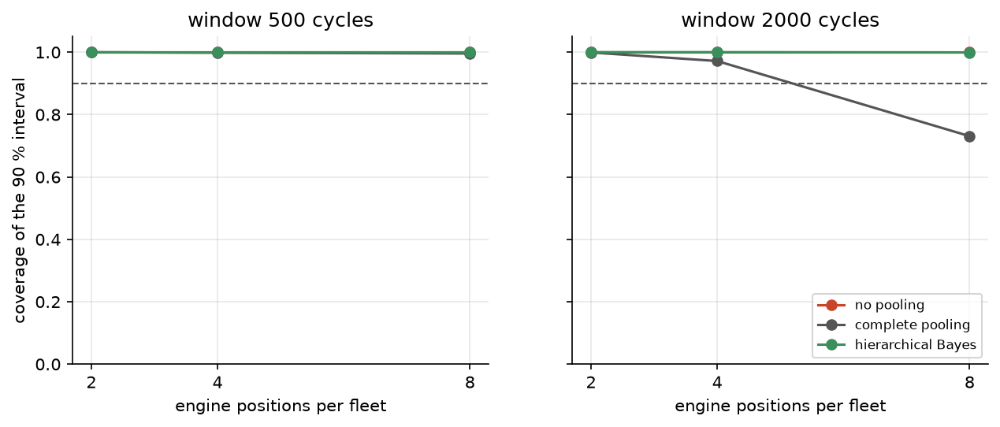

# Lesson 8 · A dataset with real ground truth

> Every result so far came from data generated by the same Poisson model the methods
> assume. That is a fair test of the arithmetic but a generous test of the methods. This
> lesson takes data from a different generator: NASA's C-MAPSS turbofan simulations, in
> which engines wear out and fail at the end of a degradation path, not at a constant rate.
> It builds four "fleets" with a known long-run failure rate and asks two questions. Do the
> methods still work when their count model is wrong? And does pooling still help when
> the units really differ?

**Code:** [`src/smallfleet/cmapss/`](../../src/smallfleet/cmapss/),
[`scripts/fetch_cmapss.py`](../../scripts/fetch_cmapss.py) ·
**Tests:** [`tests/test_cmapss.py`](../../tests/test_cmapss.py) ·
**Results:** [`validation/results/cmapss.md`](../../validation/results/cmapss.md) ·
**Previous:** [Lesson 7](07-how-big-is-a-big-fleet.md)

## Learning objectives

By the end of this lesson you should be able to:

1. Turn run-to-failure lifetimes into a fleet failure rate with the renewal theorem, and
   simulate a stationary renewal process.
2. Explain why wear-out makes failure counts under-dispersed, and what that does to
   Poisson-based intervals.
3. Read when partial pooling helps and when it costs, as the units' own data grow.
4. Handle an external dataset reproducibly: checksums, no data in the repository, and a
   documented skip in automation.

---

## 1. The data

C-MAPSS (Saxena, Goebel, Simon & Eklund, 2008) simulates turbofan engines that start with
unknown initial wear, develop a fault (high-pressure compressor degradation, and in FD003 and
FD004 also fan degradation), and run until failure. It has four subsets. In the training
files every engine runs to failure, so an engine's **life** is the number of cycles in its
record:

| subset | conditions | fault modes | engines | mean life (cycles) | cv of life | true rate (per 1000 cycles) |
|---|---|---|---|---|---|---|
| FD001 | 1 | 1 | 100 | 206.3 | 0.224 | 4.847 |
| FD002 | 6 | 1 | 260 | 206.8 | 0.226 | 4.836 |
| FD003 | 1 | 2 | 100 | 247.2 | 0.348 | 4.045 |
| FD004 | 6 | 2 | 249 | 246.0 | 0.297 | 4.065 |

(FD004's file holds 249 training engines; its readme says 248. The file is the data.)

The data are not in the repository. `scripts/fetch_cmapss.py` downloads the archive (12.4
MB) from NASA's Prognostics Center data bucket. It checks the archive and the four training
files against SHA-256 values recorded in the script, and writes them to `data/external/`,
which git ignores. The tests use a three-engine fixture in the same layout. The reproduce job
skips this study, because CI has no data.

## 2. From lifetimes to a rate

An aircraft has engine **positions**. When an engine fails it is replaced, and the
replacement's life is another draw from the same population. Each position is then a
**renewal process**, and by the renewal theorem its long-run failure rate is

```math
\lambda = \frac{1}{E[\text{life}]} \quad\Longrightarrow\quad \lambda_{FD001} = \frac{1000}{206.3} = 4.847 \text{ per 1000 cycles} .
```

That is the **known truth** each small fleet is scored against. It is computed from every
engine in the subset, which no single operator would ever see.

A fleet observed over a window of $T$ cycles must not start with brand-new engines,
or the first failures would come late. `stationary_counts` starts each position in its
**equilibrium** state. The engine in service is drawn with probability proportional to its
life (the inspection paradox: long lives are more likely to be in service at a random
moment), and its residual life is uniform over it. Then

```math
E[N(T)] = \frac{T}{E[\text{life}]} \quad \text{exactly, for every } T,
```

which a test checks by Monte Carlo for windows shorter and longer than one life.

## 3. The count model is wrong, in the safe direction

A Poisson count has variance equal to its mean. A renewal count with regular lives has much
less: if every engine lasted exactly 206 cycles, a 2000-cycle window would always see 9 or
10 failures. For a renewal process the variance-to-mean ratio of a long window tends to the
squared cv of the life distribution, here 0.05 to 0.12. From the results, for four positions:

| window | FD001 | FD002 | FD003 | FD004 |
|---|---|---|---|---|
| 500 cycles | 0.14 | 0.14 | 0.20 | 0.18 |
| 2000 cycles | 0.07 | 0.07 | 0.15 | 0.11 |

The Poisson model overstates the noise by a factor of 5 to 15, so every interval built on it is
too wide: no-pooling and hierarchical coverage is essentially 100 % instead of 90 %. That is
the safe failure mode. The opposite case is over-dispersion, from heterogeneity, clustering or
shared causes. There Poisson intervals are too narrow, which is why Lesson 4's posterior
predictive check of dispersion matters.

## 4. Does pooling help?

The four subsets are the units of the hierarchical model of Lesson 4. The hyperprior is
centred on a 250-cycle mean life (μ ~ LogNormal(ln 4, 1)), with cv ~ HalfNormal(1).
Relative RMSE, pooled over the four subsets (300 replicates, ± one standard error):

| window | positions | no pooling | complete pooling | hierarchical |
|---|---|---|---|---|
| 500 | 2 | 0.193 ± 0.004 | 0.132 ± 0.002 | **0.121 ± 0.002** |
| 500 | 8 | 0.095 ± 0.002 | 0.101 ± 0.001 | **0.081 ± 0.001** |
| 2000 | 2 | 0.076 ± 0.002 | 0.097 ± 0.001 | **0.075 ± 0.001** |
| 2000 | 8 | **0.036 ± 0.001** | 0.091 ± 0.001 | 0.055 ± 0.001 |



* **With little data, partial pooling wins.** Two positions over 500 cycles see about 4 or 5
  failures per subset. Pooling the four subsets cuts the error by 37 %.
* **With plenty of data, each fleet's own data win.** Eight positions over 2000 cycles see 65
  to 78 failures per subset. The subsets fall into two clusters (one fault mode at 4.85, two
  at 4.05), and a Gamma population of four units cannot represent that. Shrinking each subset
  towards a common mean adds bias that its own data no longer need.
* **Complete pooling becomes falsely confident** as data grow: coverage 0.73 at 8 positions
  over 2000 cycles. Its interval narrows around a rate that is wrong for every subset.

The hierarchical model never reaches complete pooling's overconfidence, and it never falls
far behind the best method. That is the property to want when you do not know in advance
how different your units are.

## 5. Worked example

FD003 has a mean life of 247.2 cycles, so its true rate is 4.045. Four positions over 500
cycles have $t = 2$ thousand cycles and expect $4.045 \times 2 = 8.1$ failures; the simulation's
mean was 8.0. A Poisson count with that mean has standard deviation 2.8. The renewal count's
variance-to-mean ratio of 0.20 gives $\sqrt{0.20 \times 8.0} = 1.3$. A 90 % Garwood interval
built for the Poisson spread is therefore about twice as wide as the data require.

## 6. Code walkthrough

```python
from pathlib import Path

import numpy as np

from smallfleet.cmapss import load_lifetimes, stationary_counts, true_rate

lives = load_lifetimes(Path("data/external/cmapss"), "FD003")  # after fetch_cmapss.py
print(true_rate(lives))  # 1000 / mean life
rng = np.random.default_rng(1)
print([stationary_counts(rng, lives, positions=4, window=500) for _ in range(5)])
```

## Exercises

1. Show that the length-biased choice followed by a uniform point gives the residual-life
   density $P(L > r)/E[L]$.
2. Why does the variance-to-mean ratio fall as the window grows, and what does it tend to?
3. Which assumption of the renewal model is most doubtful for real engines, and how would
   you test it on C-MAPSS?
4. Propose a population model that could represent the two clusters (one and two fault
   modes), and say what it would cost in data.
5. Why does over-dispersion, not under-dispersion, worry a reliability engineer more?

### Solutions

1. $P(\text{residual} > r) = \sum_\ell \frac{\ell p(\ell)}{E[L]} \cdot \frac{(\ell - r)^+}{\ell} = \frac{E[(L - r)^+]}{E[L]}$.
   Differentiating in $r$ gives the density $P(L > r)/E[L]$.
2. For a renewal process $\text{Var} N(T) \approx \sigma^2 T/\mu^3$ and $E N(T) \approx T/\mu$, so
   the ratio tends to $\sigma^2/\mu^2 = \text{cv}^2$. Short windows add the discreteness of
   0-or-1 events per position, which pushes the ratio up.
3. That replacement lives are independent draws from the subset. Real replacements are
   overhauled engines with their own wear history. On C-MAPSS one could test whether life
   depends on initial wear, using the sensor data at the start of each trajectory.
4. A two-component mixture population, or a covariate (number of fault modes) in a
   regression on log λ. Either adds parameters that four units can barely estimate. It would
   need more subsets, or engine-level data rather than fleet totals.
5. Over-dispersion makes Poisson intervals too narrow and alerts too eager to be trusted,
   and it usually signals a common cause (a batch, a maintenance practice, an environment)
   that the engineer needs to find.

## References

* A. Saxena, K. Goebel, D. Simon and N. Eklund, "Damage propagation modeling for aircraft
  engine run-to-failure simulation," *International Conference on Prognostics and Health
  Management (PHM08)*, Denver, 2008.
* A. Saxena and K. Goebel, *Turbofan Engine Degradation Simulation Data Set*, NASA Ames
  Prognostics Data Repository, 2008.
* S. M. Ross, *Stochastic Processes*, 2nd ed., Wiley, 1996 (renewal theory, the equilibrium
  distribution).
* D. R. Cox, *Renewal Theory*, Methuen, 1962 (variance of renewal counts).
